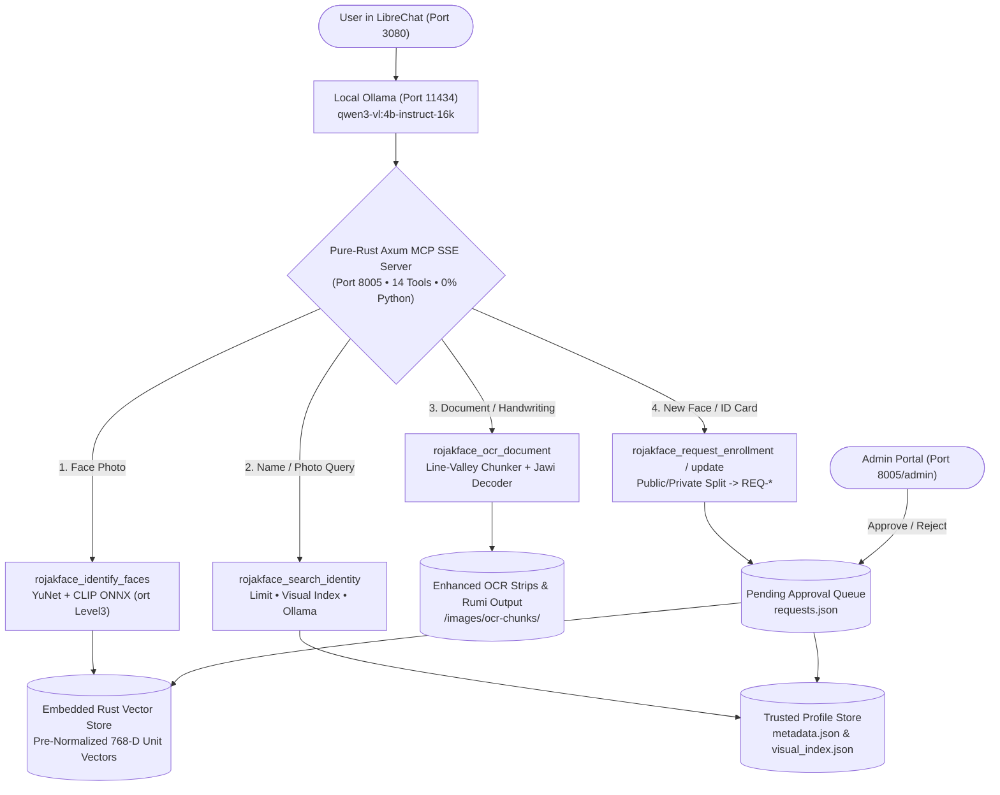

# RojakFace Enterprise Vision, Biometric Identity & Multilingual OCR Platform (Pure Rust)

An **air-gapped, 100% on-premise multimodal AI platform** written in **100% safe Rust (`#![forbid(unsafe_code)]`, 0% Python)** that integrates **Biometric Face Recognition**, **Privacy-Aware Identity & Visual Photo Retrieval**, **ID Card / Document Data Ingestion**, **Historical Script OCR (Jawi, Pallava, Kawi, Rencong)**, **Conservation/Damage Healing & Enhancement**, and **System Monitoring** natively inside **LibreChat** (`http://localhost:3080`) — including the integrated **Admin Portal** right under the MCP Settings icon — powered by a single headless compiled **Rust Axum + Tokio MCP SSE & JSON API Server** (`http://0.0.0.0:8005/sse`).


---

## Table of Contents
1. [Key Features](#1-key-features)
2. [Pure-Rust Architecture & Optimizations](#2-pure-rust-architecture--optimizations)
3. [System Requirements & Prerequisites](#3-system-requirements--prerequisites)
4. [Build & Setup Guide](#4-build--setup-guide)
5. [Running, Stopping & CLI Tools](#5-running-stopping--cli-tools)
6. [Core Processing Pipelines & 24 MCP Tools](#6-core-processing-pipelines--24-mcp-tools)
7. [Admin Portal & Public/Private Data Governance](#7-admin-portal--publicprivate-data-governance)
8. [Chatbox Usage & Example Prompts](#8-chatbox-usage--example-prompts)
9. [Project Structure](#9-project-structure)
10. [Configuration & Environment Variables](#10-configuration--environment-variables)
11. [Testing & Verification](#11-testing--verification)

---

## 1. Key Features

- **100% Pure Safe Rust Backend (`#![forbid(unsafe_code)]`, Zero Python Runtime)**: Compiles to a single ~9 MB native binary (`rojakface-server.exe`) with sub-second startup, low memory usage, true async multi-threading (`tokio` + `axum`), graceful `Ctrl+C` shutdown, and a `GET /health` endpoint.
- **100% Air-Gapped Local AI (Single Vision-Language Model)**: Zero cloud API dependencies. Runs entirely on local hardware using **Ollama (`qwen3-vl:4b-instruct-16k`)**, native **ONNX Runtime (`ort`, `GraphOptimizationLevel::Level3`)** for **YuNet** face detection and **CLIP ViT-B/32 (768-D)** embeddings, and an embedded **Pre-Normalized SIMD Cosine Vector Store** (`data/processed/rojakface_vectors.json`).
- **Biometric Face Recognition & Auto-Gallery Capture**: Identifies enrolled individuals with an anti-false-positive cosine threshold (`>= 0.88`) and automatically captures new high-confidence (`>= 0.90`), non-duplicate face angles using 16×16 perceptual average hashing (`aHash`).
- **Direct Database & Visual Attribute Photo Search**: Case- and spacing-insensitive identity lookup supporting count limits (*"3 photos only"*), photos-only rendering, and visual attribute filtering (*"photo that wear songkok"*, *"wearing glasses"*) via per-profile `visual_index.json` + async `reqwest` Ollama vision fallback.
- **Public vs. Private Data Boundary**: Profile attributes are divided into **Public Data** (shown in centered Markdown tables in chat) and **Private Data** (`license_no`, `dob`, `date_of_birth`, `ic`, `nric`, `passport`, `ssn`, `phone`, `email`, `exp`, strictly hidden from chat and editable only in the Admin Portal).
- **Historical Malay & Ancient Script OCR & Transliteration**:
  - **Adaptive Line-Valley Chunker** (`rojakface_ocr_document`): Projects horizontal edge energy in microseconds and slices tall/dense manuscripts along natural whitespace valleys (`Top`, `Middle`, `Bottom`) with auto-contrast and `1.4×` sharpening.
  - **Jawi, Pallava, Kawi & Rencong Script Decoder** (`rojakface_decode_jawi` & `rojakface_decode_ancient_script`): Restores 3-dot Jawi (`ڤ ڠ ݢ چ ڽ`), transliterates Unicode **Kawi** (`U+11F00–U+11F5F`) and **Rencong / Surat Ulu** (`U+A930–U+A95F`), normalizes **Pallava** Old Malay/Srivijaya inscriptions with archival glossary notes, and converts manuscripts into searchable digital text.
- **Computer Vision, Archival Location Recognition & Forensic Authenticity (`rojakface_analyze_image`, `rojakface_detect_authenticity`)**:
  - Recognizes buildings, landmarks, and specific archival locations (e.g., halls/wings/galleries in the **National Archives of Malaysia**) using CLIP ViT-B/32 768-D embeddings against managed **Location Folders**.
  - Extracts full technical & EXIF metadata (file name, size, MIME, dimensions, Date/Time, Camera Make/Model, GPS coordinates, Software, PNG `tEXt`/`iTXt`/`zTXt` chunks, SHA-256, perceptual `aHash`).
  - **Fraud & Authenticity Detection**: Detects exact SHA-256 archive copies, perceptual near-duplicate re-encoded copies, editing software signatures, and AI-generation markers (`Stable Diffusion`, `ComfyUI`, `Midjourney`, `DALL-E`, `Adobe Firefly`, `C2PA`, canvas heuristics).
- **Automatic Description, Archival Summarization & Managed Document Folders (`rojakface_summarize_document`, `rojakface_search_documents`)**:
  - Parses multi-format documents (**TXT, MD, CSV, JSON, HTML, XML, DOCX, PDF, and image scans**) in pure Rust, extracting concise archival summaries, key topics, names, dates, events, script type, and authenticity status.
- **Duplicate Prevention & SHA-256 Checksum Integrity (`rojakface_verify_integrity`)**: Automatically checks uploaded location photos and document files for exact SHA-256 and perceptual `aHash` duplicates across all archive folders before saving (`409 Conflict` prompt in Admin Portal) and maintains `data/processed/checksum_manifest.json` to audit corruption, tampering, missing files, and archive duplicates.
- **Image Quality, Archival Damage Detection, Healing Advice & Digital Enhancement (`rojakface_assess_conservation`, `rojakface_enhance_image`)**:
  - Analyzes **resolution**, **lighting/exposure**, and **readability/sharpness** (`0–100` scores).
  - Identifies **tear**, **faded**, **mold**, and **aging** classified into **`none` / `light` / `medium` / `heavy`**.
  - Recommends physical conservation treatments (**fungal removal**, **controlled drying**, **Japanese Kozo tissue mending**, **deacidification**, **protective coating/sizing**, **UV-filtered storage**).
  - Enhances dark, yellowed, or faded scans digitally via gray-world de-yellowing, adaptive gamma lighting, percentile autocontrast, and unsharp masking with Before vs. After metrics.
- **Administration System Performance & Overload Monitoring (`rojakface_system_health`)**: Live telemetry (`sysinfo`) of CPU %, RAM GB/%, Disk GB/%, Server Process RSS MB, Ollama ping latency, request throughput, error rates, and in-flight concurrency — detects abnormalities and burden overload (`HEALTHY` / `WARNING` / `CRITICAL_OVERLOAD`) with concrete administrative recommendations plus one-click integrity audit and temp cache cleanup in the Admin Portal.
- **Integrated LibreChat Admin Portal**: Open directly inside LibreChat (`http://localhost:3080`) via the Shield-Check icon under **MCP Settings** (same theme & layout as LibreChat) to manage **📋 Approvals**, **👥 People**, **📍 Locations**, **📁 Documents**, **📊 System & Lab**, and **🔍 Test Face**. (Standalone `http://127.0.0.1:8005/admin` is removed and redirects into LibreChat.)
- **Role-Based Governance & Security Hardening**: Chatbox users operate as **Guests** (enrollments and ID card updates are staged as `REQ-*` requests). **Admins** review requests in the session-authenticated Admin Portal. MCP endpoints enforce DNS-rebinding `Host` header validation and automatic SSE session cleanup on disconnect.

---

## 2. Pure-Rust Architecture & Optimizations



| Rust Module | Key Optimizations & Safety Properties |
| :--- | :--- |
| [src/biometrics.rs](src/biometrics.rs) | Dynamic ONNX Runtime (`ort`) with `GraphOptimizationLevel::Level3`, balanced `intra_threads` (`2..=4`) to avoid competing with Ollama, YuNet 640×640 + NMS (`IoU 0.30`), and CLIP ViT-B/32 `square_pad` + bicubic 224×224 normalization. |
| [src/vector_store.rs](src/vector_store.rs) | Pre-computes L2-normalized 768-D `unit_vector` on load/upsert so cosine search executes as a pure SIMD-auto-vectorized inner product (zero `sqrt` per candidate) with atomic temp-file rename persistence and zero file-lock conflicts. |
| [src/mcp_sse.rs](src/mcp_sse.rs) | Standard MCP 2024-11-05 SSE transport (`GET /sse`, `POST /messages/`) with `Drop`-guarded automatic session cleanup (zero leaked channels), DNS-rebinding `Host` header guard, and non-blocking `spawn_blocking` workers for heavy ONNX/image tasks. |
| [src/admin.rs](src/admin.rs) | Constant-time credential checks, `HttpOnly; SameSite=Lax` 8-hour session cookies, single-lock batch profile loading, safe filename path-traversal guards, and 32 MB multipart upload limit. |
| [src/vision_ops.rs](src/vision_ops.rs) | Pure-Rust EXIF orientation decoding (`kamadak-exif`), 16×16 perceptual `aHash`, O(N) prefix-sum moving-average OCR line-valley chunking, histogram autocontrast, and sharpening. |
| [src/jawi.rs](src/jawi.rs) | Zero-`unsafe` Jawi-to-Rumi orthographic and phonetic skeleton decoder with classical Malay dictionary and reduplication (`٢`) support. |
| [src/metadata.rs](src/metadata.rs) | Fast ASCII/Unicode profile slugging, capitalization, 12-hour AM/PM time formatting, sensitive-field privacy classification, and truncated JSON recovery. |
| [src/service.rs](src/service.rs) | Orchestrates all 14 MCP tools, LibreChat attachment resolution (skipping `profile-gallery/`, `ocr-chunks/`, and `identity-gallery/`), perceptual ID cache, auto-gallery capture, staging queue, and pure-Rust batch directory enrollment. |

---

## 3. System Requirements & Prerequisites

| Requirement | Minimum / Recommended Specification |
| :--- | :--- |
| **Operating System** | Windows 10/11 (64-bit), Linux, or macOS |
| **Rust Toolchain** | Rust **1.97+** (`cargo`, `rustc`) — *no Python required at runtime* |
| **ONNX Runtime & Models** | `onnxruntime.dll` (or `.so`/`.dylib`) in `models/runtime/`, plus `yunet_face_detector.onnx` and `patch32_v1.onnx` in `models/` (or `~/.cache/`) |
| **Docker** | **Docker Desktop** (Compose v2) for LibreChat (`http://localhost:3080`) |
| **Ollama** | **Ollama** (`http://127.0.0.1:11434`) running `qwen3-vl:4b-instruct-16k` |

---

## 4. Build & Setup Guide

### Step 1 — Clone & Compile the Pure-Rust Binary
```powershell
git clone https://github.com/Hamzahxvi/rojakface-enterprise-vision.git
cd rojakface-enterprise-vision

cargo build --release
```

### Step 2 — Pull & Build the Local Ollama Model
```powershell
ollama pull qwen3-vl:4b-instruct
ollama create qwen3-vl:4b-instruct-16k -f models/Modelfile
```

### Step 3 — Configure Sibling LibreChat (`../LibreChat`)
```powershell
if (-not (Test-Path ..\LibreChat)) {
    git clone https://github.com/danny-avila/LibreChat.git ..\LibreChat
    Copy-Item ..\LibreChat\.env.example ..\LibreChat\.env
}
New-Item -ItemType Directory -Force -Path ..\LibreChat\images | Out-Null

Copy-Item config\librechat\librechat.yaml ..\LibreChat\librechat.yaml -Force
Copy-Item config\librechat\docker-compose.override.yml ..\LibreChat\docker-compose.override.yml -Force
Copy-Item config\librechat\custom-index.html ..\LibreChat\custom-index.html -Force
Copy-Item config\librechat\royal-theme.css ..\LibreChat\images\royal-theme.css -Force
Copy-Item config\librechat\admin-embed.js ..\LibreChat\images\admin-embed.js -Force
```

### Step 4 — Optional First-Time Batch Face Enrollment (Pure Rust)
Seed the embedded vector store (`data/processed/rojakface_vectors.json`) and profile galleries from `data/raw/staff_enroll/`:
```powershell
.\target\release\rojakface-server.exe --enroll-dir data\raw\staff_enroll
```

---

## 5. Running, Stopping & CLI Tools

### One-Click Launch & Shutdown (Windows)
```powershell
# Start Ollama + rojakface-server.exe (8005) + LibreChat (3080)
cmd /c start.bat

# Stop rojakface-server.exe cleanly
cmd /c stop.bat
```

### Manual CLI Commands & Health Check
```powershell
# Run the MCP SSE + Admin Portal server
.\target\release\rojakface-server.exe

# Health check endpoint
curl http://127.0.0.1:8005/health

# Offline biometric face identification check on any image
.\target\release\rojakface-server.exe --verify-face path\to\portrait.jpg

# Batch enroll all subdirectories under a folder (<dir>/<Person Name>/*.jpg)
.\target\release\rojakface-server.exe --enroll-dir data\raw\staff_enroll
```

---

## 6. Core Processing Pipelines & 24 MCP Tools

Exposed over standard MCP SSE (`http://host.docker.internal:8005/sse` and `/messages/`):

| Pipeline | MCP Tool | Description |
| :--- | :--- | :--- |
| **Pipeline A: Biometric Face ID** | `rojakface_identify_faces` | YuNet face detection + 768-D CLIP embeddings + SIMD cosine match (`>= 0.88`), auto-gallery capture (`>= 0.90`), returns `MATCHED`, `NOT_IN_DATABASE`, or `NO_FACE_DETECTED` (with `ocr_document_chunks`). |
| | `rojakface_detect_faces` | Low-level YuNet bounding box `[x, y, w, h]` and confidence inspection. |
| **Pipeline B: People, Locations & Documents Search** | `rojakface_search_identity` | Case/spacing-insensitive profile lookup supporting `limit`, `photos_only`, and bilingual English/Malay visual `query`. |
| | `rojakface_list_identities` | Lists all enrolled identities and reference vector counts. |
| | `rojakface_search_locations` | Searches/lists managed archival **Location** folders (e.g. Arkib Negara Malaysia halls/wings/rooms) with coordinates, history, and gallery photos. |
| | `rojakface_search_documents` | Searches/lists managed archival **Document** folders by title, reference code, script, topic, or extracted digital text. |
| **Pipeline C: Historical Script OCR & Archival Vision** | `rojakface_ocr_document` | Adaptive horizontal edge-energy line-valley chunking with autocontrast & `1.4×` sharpening (`/images/ocr-chunks/`). |
| | `rojakface_decode_jawi` | Decodes Jawi script or rough transliterations into corrected 3-dot Jawi (`ڤ ڠ ݢ چ ڽ`) and Standard Bahasa Melayu (Rumi). |
| | `rojakface_decode_ancient_script` | Auto-detects & transliterates **Jawi**, **Pallava**, **Kawi** (`U+11F00–U+11F5F`), and **Rencong / Surat Ulu** (`U+A930–U+A95F`) with archival Old Malay glossary notes. |
| | `rojakface_analyze_image` | Extracts full file/EXIF/GPS/PNG metadata, runs authenticity/fraud analysis, and matches buildings/landmarks via CLIP 768-D against managed Locations. |
| | `rojakface_detect_authenticity` | Forensic detector for **Original vs Exact Copy (SHA-256) vs Near-Duplicate Copy (`aHash`) vs Edited vs AI-Generated** files/images. |
| | `rojakface_summarize_document` | Multi-format (TXT/MD/CSV/JSON/HTML/DOCX/PDF/Image) automatic archival description & structured summary (topics, names, dates, events, authenticity). |
| **Pipeline D: Archival Conservation, Integrity & Ops** | `rojakface_assess_conservation` | Evaluates resolution, lighting, readability, detects tear/faded/mold/aging (`none`/`light`/`medium`/`heavy`), checks authenticity/duplicates, and suggests physical healing treatments. |
| | `rojakface_enhance_image` | Digitally enhances dark, yellowed, or faded archival images (white balance de-yellowing, gamma lighting, autocontrast, unsharp mask) with Before vs. After quality scores. |
| | `rojakface_verify_integrity` | Audits SHA-256 file integrity across `profiles/`, `locations/`, and `documents/` against `checksum_manifest.json` to flag corruption, tampering, missing files, and exact duplicates. |
| | `rojakface_system_health` | Live administration telemetry (CPU, RAM, Disk, Ollama latency, workload/errors) with abnormality/overload detection (`HEALTHY`/`WARNING`/`CRITICAL_OVERLOAD`) and recommended actions. |
| **Pipeline E: Role-Based Governance** | `rojakface_request_enrollment` | Stages a Guest enrollment request (`REQ-*`) for Admin review. |
| | `rojakface_request_update_metadata` | Stages a Guest metadata/MyKad/ID-card update request (`REQ-*`), auto-classifying English & Malay sensitive keys as `private`. |
| | `rojakface_list_pending_requests` | Lists pending, approved, or rejected staging requests. |
| | `rojakface_review_pending_request` | Admin-key guarded approval/rejection tool. |
| | `rojakface_enroll_named_identity` | Admin direct enrollment tool (auto-stages for Guests). |
| | `rojakface_enroll_or_learn` | Admin batch learning tool. |
| | `rojakface_rename_identity` | Admin rename across vector store, profiles, and gallery. |
| | `rojakface_delete_identity` | Admin delete across vector store and stored files. |

---

## 7. Admin Portal & Public/Private Data Governance

Open **LibreChat (`http://localhost:3080`)** and click the **Admin Portal** shield-check icon directly underneath **MCP Settings** in the left navigation rail:
- **Native LibreChat Theme & Layout**: Rendered directly inside LibreChat using LibreChat's exact Light/Dark CSS variables (no separate standalone port-8005 page or iframe).
- **Session Auth**: Constant-time credential verification (`POST /admin/api/login`) with 8-hour `HttpOnly` session cookies (`ROJAKFACE_ADMIN_USER` / `ROJAKFACE_ADMIN_PASS`).
- **6 Integrated Tabs**: **📋 Approvals** (guest staging queue), **👥 People** (Public vs. Private custom fields & per-photo metadata), **📍 Locations** (CLIP-indexed halls/wings with duplicate guard), **📁 Documents** (multi-format upload, duplicate guard & Auto-Summarize), **📊 System & Lab** (live CPU/RAM/Disk/Ollama telemetry, SHA-256 integrity check, cache cleanup, & archival quality/damage/enhancement lab), and **🔍 Test Face**.

---

## 8. Chatbox Usage & Example Prompts (English & Bahasa Melayu)

### English Prompts
- **Face Identification** *(attach portrait)*: `who is this? show all his details and photos`
- **Profile Lookup**: `show eula lawrence full details` / `show azhar idrus details`
- **Photo Limits & Visual Search**: `show lando zawawi photos. 2 photos only.` / `show lando zawawi photo that wear songkok`
- **Multilingual OCR** *(attach document/handwriting)*: `read this jawi text, convert to rumi, and explain the meaning` / `transcribe this sanskrit text chunk by chunk`
- **Guest Staging**: `enroll this person as Ahmad Faizal` / `extract all details from this ID card and save them to Carl Johnson's profile`

### Bahasa Melayu (Malaysia) Prompts
- **Pengecaman Wajah** *(lampirkan gambar)*: `siapa ini? tunjuk maklumat penuh dan semua gambar beliau`
- **Carian Profil**: `tunjuk maklumat penuh eula lawrence` / `siapa azhar idrus?`
- **Had Gambar & Carian Visual**: `tunjuk 2 gambar lando zawawi sahaja` / `tunjuk gambar lando zawawi yang pakai cermin mata` / `tunjuk gambar lando zawawi yang pakai songkok`
- **OCR Dokumen & Jawi** *(lampirkan dokumen/tulisan tangan)*: `baca tulisan jawi ini, tukar ke rumi, dan jelaskan maksudnya`
- **Pendaftaran & Kad Pengenalan**: `daftar orang ini sebagai Ahmad Faizal` / `ekstrak maklumat kad pengenalan ini dan simpan ke profil Carl Johnson`

---

## 9. Project Structure

```text
├── Cargo.toml                      # Pure-Rust package manifest (rojakface-server v2.0.0)
├── Cargo.lock                      # Reproducible Rust dependency lockfile
├── src/                            # 100% safe Rust (#![forbid(unsafe_code)])
│   ├── main.rs                     # Tokio + Axum server, /health, graceful shutdown & CLI flags
│   ├── config.rs                   # Environment config, paths & ONNX/DLL auto-discovery
│   ├── biometrics.rs               # Native YuNet ONNX face detector + CLIP ViT-B/32 embedder
│   ├── vector_store.rs             # Embedded pre-normalized 768-D SIMD cosine vector store
│   ├── vision_ops.rs               # EXIF orientation, perceptual aHash, OCR line-valley chunker
│   ├── jawi.rs                     # Jawi-to-Rumi orthographic & phonetic skeleton decoder
│   ├── ancient_scripts.rs          # Jawi, Pallava, Kawi & Rencong script decoder & glossary
│   ├── forensics.rs                # File/EXIF/GPS/PNG metadata, duplicate guard, SHA-256 integrity & AI/Copy fraud engine
│   ├── conservation.rs             # Image quality, tear/faded/mold/aging classifier, healing advice & digital enhancement
│   ├── monitor.rs                  # Live CPU/RAM/Disk/Ollama telemetry, abnormality & burden overload advisor
│   ├── archives.rs                 # Managed Location & Document folders + PDF/DOCX/TXT summarizer
│   ├── metadata.rs                 # Slugs, identity normalization, 12h time, bilingual privacy keys
│   ├── service.rs                  # Core business logic backing all 24 MCP tools & Admin APIs
│   ├── mcp_sse.rs                  # MCP-over-SSE server (/sse & /messages/) + DNS guard
│   └── admin.rs                    # Headless CORS-enabled JSON Admin API consumed natively by LibreChat
├── config/
│   ├── librechat/                  # librechat.yaml, docker-compose.override.yml, custom-index.html, royal-theme.css, admin-embed.js
│   └── settings.json               # Thresholds, ports & vector store settings
├── data/
│   └── raw/staff_enroll/           # Sample enrollment source portraits
├── models/
│   └── Modelfile                   # Ollama Modelfile for qwen3-vl:4b-instruct-16k
├── reports/
│   └── pipeline_diagram.svg        # Pure-Rust architecture diagram
├── Dockerfile                      # Multi-stage Pure-Rust Docker image with HEALTHCHECK
├── start.bat                       # One-click launch (Ollama + rojakface-server.exe + LibreChat)
├── stop.bat                        # One-click shutdown for rojakface-server.exe
└── README.md
```

---

## 10. Configuration & Environment Variables

| Variable | Default | Purpose |
| :--- | :--- | :--- |
| `ROJAKFACE_HOST` | `0.0.0.0` | Bind host for MCP SSE, `/health`, & Admin Portal |
| `ROJAKFACE_PORT` | `8005` | Port for `/sse`, `/health`, and `/admin` |
| `ROJAKFACE_ADMIN_USER` | `admin` | Admin Portal login username |
| `ROJAKFACE_ADMIN_PASS` | `admin123` | Admin Portal login password (override in production) |
| `ROJAKFACE_ADMIN_KEY` | *(persisted in `.rojakface_admin_key`)* | Internal secret key for Admin-only MCP operations |
| `ROJAKFACE_OLLAMA_URL` | `http://127.0.0.1:11434/api/chat` | Local Ollama endpoint for visual attribute fallback |
| `ROJAKFACE_VISION_MODEL` | `qwen3-vl:4b-instruct-16k` | Local Ollama vision model |
| `ORT_DYLIB_PATH` | *(auto-discovered in `models/runtime/`)* | Path to `onnxruntime.dll` / `libonnxruntime.so` |
| `ROJAKFACE_YUNET_MODEL` | *(auto-discovered in `models/` or `~/.cache/`)* | Path to `yunet_face_detector.onnx` |
| `ROJAKFACE_CLIP_MODEL` | *(auto-discovered in `models/` or `~/.cache/`)* | Path to `patch32_v1.onnx` |
| `LIBRECHAT_DIR` | `../LibreChat` | Path to sibling LibreChat directory |
| `LIBRECHAT_URL` | `http://localhost:3080` | Base URL for profile gallery & OCR chunk links |

---

## 11. Testing & Verification

```powershell
# Format check + strict zero-warning lint
cargo fmt --check
cargo clippy --all-targets -- -D warnings

# Run all unit tests (biometrics, vector store, vision ops, Jawi, metadata, MCP catalog)
cargo test

# Build optimized release binary
cargo build --release
```
