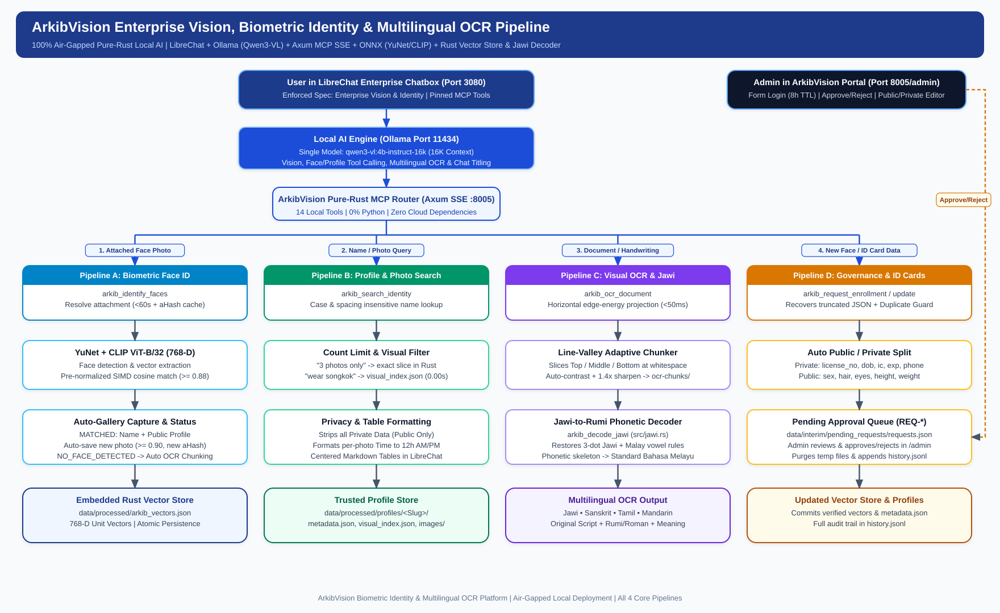
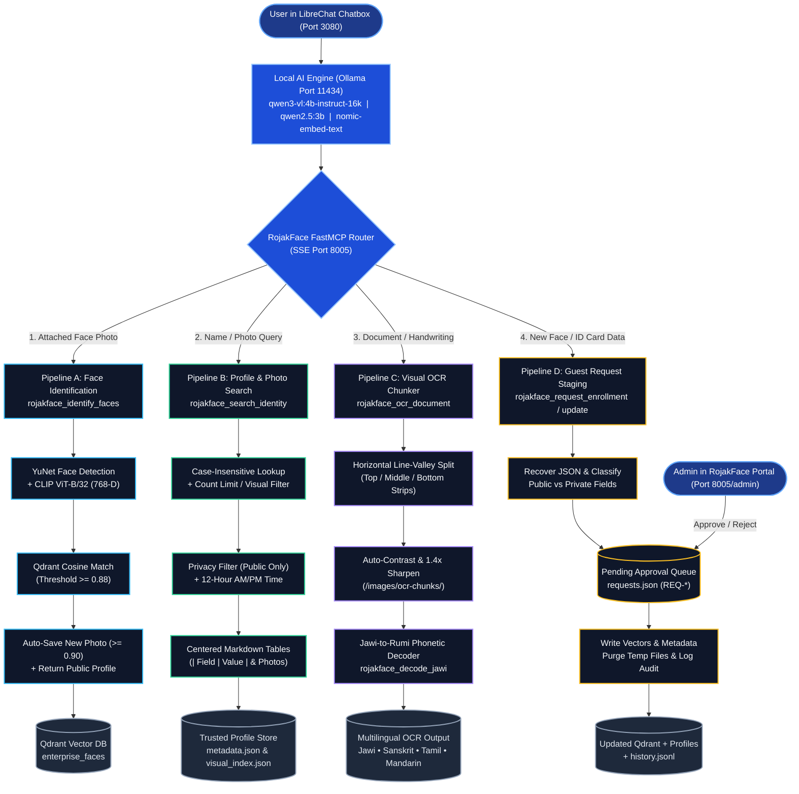

# RojakFace Enterprise Vision, Biometric Identity & Multilingual OCR Platform

An **air-gapped, 100% on-premise multimodal AI platform** that integrates **Biometric Face Recognition**, **Privacy-Aware Identity & Visual Photo Retrieval**, **ID Card / Document Data Ingestion**, and **Multilingual Document & Handwriting OCR (Jawi, Sanskrit, Tamil, Mandarin, Malay, English)** inside **LibreChat** (`http://localhost:3080`), powered by a role-governed **FastMCP Server** (`http://0.0.0.0:8005/sse`) and **Admin Portal** (`http://127.0.0.1:8005/admin`).



---

## Table of Contents
1. [Key Features](#1-key-features)
2. [System Pipeline Architecture](#2-system-pipeline-architecture)
3. [System Requirements & Prerequisites](#3-system-requirements--prerequisites)
4. [Installation & Setup Guide](#4-installation--setup-guide)
5. [Running & Stopping the Platform](#5-running--stopping-the-platform)
6. [Core Processing Pipelines & MCP Tools](#6-core-processing-pipelines--mcp-tools)
7. [Admin Portal & Public/Private Data Governance](#7-admin-portal--publicprivate-data-governance)
8. [Chatbox Usage & Example Prompts](#8-chatbox-usage--example-prompts)
9. [Project Structure](#9-project-structure)
10. [Configuration & Environment Variables](#10-configuration--environment-variables)
11. [Testing & Troubleshooting](#11-testing--troubleshooting)

---

## 1. Key Features

- **100% Air-Gapped Local AI**: Zero cloud API dependencies. Runs entirely on local hardware using **Ollama** (`qwen3-vl:4b-instruct-16k`, `qwen2.5:3b`, `nomic-embed-text:latest`), **YuNet ONNX** face detection, **CLIP ViT-B/32 (768-D)** embeddings, and **Qdrant** vector search.
- **Biometric Face Recognition & Auto-Gallery Capture**: Identifies enrolled individuals with an anti-false-positive cosine threshold (`>= 0.88`) and automatically captures new high-confidence (`>= 0.90`), non-duplicate face angles into the person's profile gallery using 16×16 perceptual average hashing (`aHash`).
- **Direct Database & Visual Attribute Photo Search**: Case- and spacing-insensitive identity lookup supporting count limits (*"3 photos only"*), photos-only rendering, and visual attribute filtering (*"photo that wear songkok"*, *"wearing glasses"*) in `0.00s` via per-profile `visual_index.json` + local VLM fallback.
- **Public vs. Private Data Boundary**: Profile attributes are divided into **🌐 Public Data** (shown in chatbox Markdown tables) and **🔒 Private Data** (e.g., `license_no`, `dob`, `ic`, `nric`, `passport`, `exp`, `phone`, strictly hidden from chat and accessible only in the Admin Portal).
- **Multilingual Document & Handwriting OCR with Visual Chunking**:
  - **Adaptive Line-Valley Chunker** (`rojakface_ocr_document`): Projects horizontal edge energy in `< 50ms` to count exact text lines and slices tall/dense manuscripts along natural whitespace valleys (`Top`, `Middle`, `Bottom`) with `1.4×` sharpening and auto-contrast so small diacritics are never clipped and lines are never skipped.
  - **Jawi-to-Rumi Orthographic & Phonetic Decoder** (`rojakface_decode_jawi`): Restores 3-dot Jawi letters (`ڤ`=`p`, `ڠ`=`ng`, `ݢ`=`g`, `چ`=`c`, `ڽ`=`ny`), applies classical Jawi vowel rules (`ى`→`-a`, `ي`→`e`, `ؤ`→`o`, `٢`→word reduplication), and matches Jawi phonetic skeletons against a Bahasa Melayu Rumi lexicon.
  - Supports **Jawi**, **Sanskrit (Devanagari)**, **Tamil**, **Mandarin Chinese**, **Bahasa Melayu**, and **English** printed documents and handwriting.
- **Role-Based Governance (Guest vs. Admin)**: Chatbox users operate as **Guests** (read-only search; new enrollments and ID card metadata updates are staged as `REQ-*` requests). **Admins** review, approve, or reject requests and manage profiles in the authenticated Admin Portal.

---

## 2. System Pipeline Architecture



---

## 3. System Requirements & Prerequisites

| Requirement | Minimum / Recommended Specification |
| :--- | :--- |
| **Operating System** | Windows 10/11 (64-bit), Linux, or macOS |
| **Memory (RAM / VRAM)** | 16 GB RAM minimum (GPU with >= 6 GB VRAM recommended for faster VLM inference) |
| **Python** | Python **3.11+** (tested on Python 3.13) |
| **Docker** | **Docker Desktop** (with Docker Compose v2) for running LibreChat, MongoDB, Meilisearch, and pgvector RAG |
| **Ollama** | **Ollama** (`http://127.0.0.1:11434`) installed and available on `PATH` |
| **Sibling LibreChat Repo** | LibreChat cloned as a sibling folder at `../LibreChat` (or path configured via `LIBRECHAT_DIR`) |

---

## 4. Installation & Setup Guide

### Step 1 — Clone the Repository & Create the Python Virtual Environment
```powershell
git clone <your-github-repo-url> "test image to text"
cd "test image to text"

python -m venv .venv
.\.venv\Scripts\activate
pip install --upgrade pip
pip install -r requirements.txt
# Or install as an editable package:
pip install -e .
```

### Step 2 — Pull & Build the Required Local Ollama Models
Ensure Ollama is running (`ollama serve`), then pull the required models and build the 16K-context vision model from `models/Modelfile`:
```powershell
ollama pull qwen3-vl:4b-instruct
ollama create qwen3-vl:4b-instruct-16k -f models/Modelfile

ollama pull qwen2.5:3b
ollama pull nomic-embed-text:latest
```

### Step 3 — Apply LibreChat Configuration & Theme Snapshots
Copy the provided LibreChat configuration files from `config/librechat/` into your sibling `../LibreChat/` directory:
```powershell
Copy-Item config\librechat\librechat.yaml ..\LibreChat\librechat.yaml -Force
Copy-Item config\librechat\docker-compose.override.yml ..\LibreChat\docker-compose.override.yml -Force
Copy-Item config\librechat\custom-index.html ..\LibreChat\custom-index.html -Force
Copy-Item config\librechat\royal-theme.css ..\LibreChat\images\royal-theme.css -Force
```

### Step 4 — Initialize the Enrolled Face Database & Profiles (Optional First-Time Seed)
To seed the Qdrant vector database (`data/processed/rojakface_qdrant`) and build the initial profile folders (`data/processed/profiles/`) from `data/raw/staff_enroll/`:
```powershell
.\.venv\Scripts\python.exe src\data\prepare_default20.py
.\.venv\Scripts\python.exe src\data\batch_enroll.py
.\.venv\Scripts\python.exe src\data\build_profiles.py
```

---

## 5. Running & Stopping the Platform

### One-Click Launch (Windows)
Double-click **`start.bat`** or run from PowerShell/CMD:
```powershell
cmd /c start.bat
```
`start.bat` automatically:
1. Checks and starts **Ollama** (`127.0.0.1:11434`).
2. Starts the **RojakFace FastMCP & Admin Portal Service** (`0.0.0.0:8005`).
3. Starts the **LibreChat Docker containers** (`localhost:3080`).
4. Opens `http://localhost:3080` in your default browser once ready.

### One-Click Shutdown (Windows)
```powershell
cmd /c stop.bat
```
*(Note: Always stop `rojakface_mcp.py` via `stop.bat` before running offline Qdrant scripts so the embedded Qdrant storage lock is released cleanly.)*

### Manual CLI Startup
```powershell
.\.venv\Scripts\python.exe src\models\rojakface_mcp.py
```

---

## 6. Core Processing Pipelines & MCP Tools

The FastMCP server ([src/models/rojakface_mcp.py](src/models/rojakface_mcp.py)) exposes **14 MCP tools** over SSE (`http://host.docker.internal:8005/sse`):

| Pipeline | MCP Tool | Description |
| :--- | :--- | :--- |
| **Pipeline A: Biometric Face ID** | `rojakface_identify_faces` | Detects faces via YuNet, extracts 768-D CLIP embeddings, queries Qdrant (`threshold >= 0.88`), auto-saves high-confidence (`>= 0.90`) new photos to the person's gallery, and returns `MATCHED` (with `matched_profiles`), `NOT_IN_DATABASE`, or `NO_FACE_DETECTED` (with `ocr_document_chunks`). |
| | `rojakface_detect_faces` | Low-level YuNet bounding box `[x, y, w, h]` and confidence inspection. |
| **Pipeline B: Database & Photo Search** | `rojakface_search_identity` | Case- and spacing-insensitive profile lookup supporting `limit` (*"3 photos only"*), `photos_only=True`, and `query` (*"wear songkok"*) via `visual_index.json` + local Ollama vision fallback. Filters out Private Data and formats per-photo `Time` in 12-hour AM/PM. |
| | `rojakface_list_identities` | Lists all enrolled identities in Qdrant and their vector counts. |
| **Pipeline C: Document Chunking & Jawi OCR** | `rojakface_ocr_document` | Projects horizontal edge energy (`< 50ms`) to count exact text lines and slices tall/dense documents along natural whitespace line valleys into contrast-enhanced strips (`/images/ocr-chunks/`). |
| | `rojakface_decode_jawi` | Decodes Jawi script or rough VLM transliterations into corrected 3-dot Jawi (`ڤ ڠ ݢ چ ڽ`) and natural Standard Bahasa Melayu (Rumi) via [src/utils/jawi_decoder.py](src/utils/jawi_decoder.py). |
| **Pipeline D: Role-Based Governance** | `rojakface_request_enrollment` | Stages a Guest face enrollment request (`REQ-*`) for Admin review (auto-routes to metadata update if the face already matches an enrolled person). |
| | `rojakface_request_update_metadata` | Stages a Guest metadata/ID-card update request (`REQ-*`), recovering truncated JSON and auto-classifying sensitive keys as `private`. |
| | `rojakface_list_pending_requests` | Lists pending, approved, or rejected requests in the staging queue. |
| | `rojakface_review_pending_request` | Admin-key guarded approval/rejection tool. |
| | `rojakface_enroll_named_identity` | Admin direct enrollment tool (falls back to staging queue for Guests). |
| | `rojakface_enroll_or_learn` | Admin batch learning tool. |
| | `rojakface_rename_identity` | Admin tool to rename an identity across Qdrant and profile folders. |
| | `rojakface_delete_identity` | Admin tool to delete an identity and purge its stored face crops/originals. |

---

## 7. Admin Portal & Public/Private Data Governance

Open **`http://127.0.0.1:8005/admin`** in your browser:

- **Authentication**: Protected by form login with an 8-hour server-side session TTL (default username: `admin`, password configured via `ROJAKFACE_ADMIN_PASS`).
- **Pending Approval Queue**: View source photos, face crops, and extracted ID card fields for every pending `REQ-*` submission. Click **✅ Approve** or **❌ Reject** (staged temp images are automatically cleaned up and logged to `data/interim/pending_requests/history.jsonl`).
- **Trusted Profile Editor**:
  - Edit **Name**, **Address**, and **Notes**.
  - Click any stored photo to edit its individual **Photo description**, **Photograph by**, **Location**, **Date**, and **Time**, or upload/delete reference photos.
  - **Side-by-Side Data Privacy Split**:
    - **🌐 Public Data (Left Panel)**: Visible in LibreChat responses when users search for a person's details.
    - **🔒 Private Data (Right Panel)**: Hidden from LibreChat chat responses (e.g., `license_no`, `dob`, `exp`, `ic`, `nric`, `passport`, `phone`). Use the `←` / `→` button to move any field between Public and Private at any time.
- **Recognition Test Bench** (`http://127.0.0.1:8005/admin/test-recognition`): Upload test images and tune the similarity threshold (`0.88–0.98`) without saving test images into production galleries.

---

## 8. Chatbox Usage & Example Prompts

### A. Retrieve Photos by Name, Count, or Visual Attribute (No Attachment Needed)
- `show lando zawawi photos. 3 photos only.`
- `show lando zawawi photo that wear songkok`
- `show lando zawawi photo wearing glasses`
- `show lando zawawi photo wearing plaid shirt`
- `show lando zawawi photo wearing pirate hat`
- `show carl johnson photos only`

### B. Full Public Profile Details & Centered Per-Image Tables (Case-Insensitive)
- `show lando zawawi all his details`
- `show Lando Zawawi details`
- `who is carl johnson? show all details`
- `show details about Anwar Ibrahim`

### C. Multilingual Handwriting & Document OCR (Attach Document / Handwriting Image)
- **Jawi**: `read this jawi text, convert to rumi, and explain the meaning`
- **Sanskrit**: `transcribe this sanskrit text chunk by chunk, provide romanized transliteration, and translate to english`
- **Tamil**: `read this tamil handwriting line by line with romanization and english translation`
- **Mandarin**: `read this mandarin handwriting and show chinese characters, pinyin, and english meaning`
- **Structured Document / Form**: `OCR this document and extract all key fields in a table`

### D. Face Identification, ID Card Ingestion & Enrollment (Attach Photo / ID Card)
- *(Attach photo of enrolled person)* → `who is this? show his details`
- *(Attach photo of unknown person)* → `who is this?`
- *(Attach photo of unknown person)* → `enroll this person as Farid Azizan`
- *(Attach driver's license / ID card)* → `save this data in his profile`
- *(Check approval queue)* → `list pending requests`

---

## 9. Project Structure

```text
├── config/                         # Service settings & LibreChat configuration snapshots
│   ├── librechat/
│   │   ├── custom-index.html       # Pre-boot ensureMcp script & theme loader (?v=4)
│   │   ├── docker-compose.override.yml
│   │   ├── librechat.yaml          # Enforced Enterprise Vision & Identity spec & pinned MCP
│   │   └── royal-theme.css         # White/Royal Blue & Dark Slate theme + centered tables
│   ├── docker-compose.qdrant.yml
│   └── settings.json
├── data/
│   ├── raw/                        # Immutable enrollment source portraits (staff_enroll/)
│   ├── interim/                    # Git-ignored staging queue (pending_requests/) & store-faces/
│   └── processed/                  # Git-ignored Qdrant DB (rojakface_qdrant/) & profiles/
├── models/                         # Ollama Modelfile for qwen3-vl:4b-instruct-16k
│   └── Modelfile
├── reports/                        # Scalable vector pipeline architecture diagram
│   └── pipeline_diagram.svg
├── src/
│   ├── data/                       # Ingestion and batch enrollment scripts
│   │   ├── batch_enroll.py
│   │   ├── build_profiles.py
│   │   └── prepare_default20.py
│   ├── models/                     # FastMCP server & Admin Portal
│   │   ├── admin_portal/           # login.html, dashboard.html, test_recognition.html
│   │   ├── admin_routes.py         # Admin HTTP endpoints & session auth middleware
│   │   └── rojakface_mcp.py        # FastMCP SSE server (14 tools)
│   └── utils/                      # Shared utilities
│       ├── face_utils.py           # Profile sync & face crop helpers
│       ├── jawi_decoder.py         # Jawi-to-Rumi orthographic & phonetic skeleton decoder
│       ├── paths.py                # Centralized project paths
│       └── qdrant_helper.py        # Qdrant client factory
├── tests/                          # Unit and validation tests
│   └── test_core.py
├── .gitignore
├── Dockerfile
├── pyproject.toml
├── requirements.txt
├── start.bat                       # One-click launch (Ollama + RojakFace MCP + LibreChat)
├── stop.bat                        # One-click shutdown for RojakFace MCP
└── README.md
```

---

## 10. Configuration & Environment Variables

| Variable | Default | Purpose |
| :--- | :--- | :--- |
| `ROJAKFACE_HOST` | `0.0.0.0` | Host address for the FastMCP & Admin Portal server |
| `ROJAKFACE_PORT` | `8005` | Port for the FastMCP SSE endpoint (`/sse`) and Admin Portal (`/admin`) |
| `ROJAKFACE_ADMIN_USER` | `admin` | Admin Portal login username |
| `ROJAKFACE_ADMIN_PASS` | *(auto/default)* | Admin Portal login password (set a strong password in production) |
| `ROJAKFACE_ADMIN_KEY` | *(persisted in `.rojakface_admin_key`)* | Internal secret key for Admin-only MCP operations |
| `ROJAKFACE_OLLAMA_URL` | `http://127.0.0.1:11434/api/chat` | Local Ollama chat endpoint used for visual attribute fallback |
| `ROJAKFACE_VISION_MODEL` | `qwen3-vl:4b-instruct-16k` | Local Ollama vision model name |
| `LIBRECHAT_DIR` | `../LibreChat` | Path to sibling LibreChat directory for shared static image mounts |
| `LIBRECHAT_URL` | `http://localhost:3080` | Base URL used when constructing profile and OCR chunk image links |

---

## 11. Testing & Troubleshooting

### Run the Automated Test Suite
```powershell
.\.venv\Scripts\python.exe -m unittest discover -s tests -v
```

### Common Troubleshooting
1. **`portalocker.exceptions.AlreadyLocked` when running offline scripts**:
   - Embedded Qdrant locks `data/processed/rojakface_qdrant` while `rojakface_mcp.py` is running. Run `cmd /c stop.bat` before running offline batch scripts, then run `cmd /c start.bat` again.
2. **Changes to `librechat.yaml` or `custom-index.html` not appearing**:
   - Copy updated files to `../LibreChat/`, run `docker compose restart api` inside `../LibreChat`, and perform a hard refresh (`Ctrl+F5`) in your browser.
3. **Resetting or Re-seeding Profiles**:
   - Stop the MCP server (`cmd /c stop.bat`), run `python src/data/build_profiles.py`, and restart (`cmd /c start.bat`).
