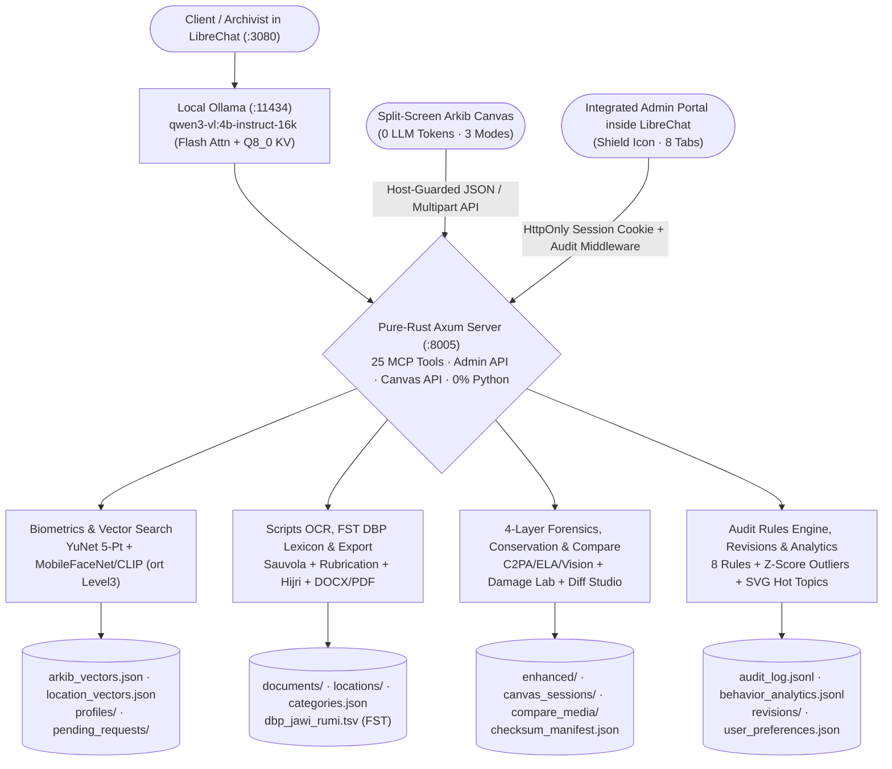

# ArkibVision Enterprise Archival Vision, Biometrics, Forensics & Governance Platform (Pure Rust)

An **air-gapped, 100% on-premise multimodal AI & archival governance platform** written in **100% Pure Safe Rust (`#![forbid(unsafe_code)]`, 0% Python)** that integrates **Biometric Face Recognition**, **Privacy-Aware Identity & Visual Photo Retrieval**, **Historical Script OCR (Jawi, Pallava, Kawi, Rencong) + FST DBP Lexicon & Hijri→Masihi Colophon Parsing**, **4-Layer Deep Authenticity & AI Watermark Forensics**, **Archival Conservation / Damage Healing & Enhancement**, **Split-Screen Arkib Canvas (Jawi OCR Workbench, Identity Enrollment, Interactive Before/After Comparison Studio)**, **Pure-Rust DOCX/PDF Export**, **Audit Rules Engine & Outlier Detection**, **Before/After Revision Tracking**, and **User Behavior & Hot-Topics SVG Analytics** natively inside **LibreChat** (`http://localhost:3080`) — powered by a single compiled **Rust Axum + Tokio MCP SSE & Headless JSON API Server** (`http://0.0.0.0:8005/sse`).


---

## Table of Contents
1. [Key Features](#1-key-features)
2. [Pure-Rust Architecture & Performance Optimizations](#2-pure-rust-architecture--performance-optimizations)
3. [Split-Screen Arkib Canvas (3 Interactive Modes)](#3-split-screen-arkib-canvas-3-interactive-modes)
4. [4-Layer Deep Authenticity & AI Watermark Engine](#4-4-layer-deep-authenticity--ai-watermark-engine)
5. [Audit Management, Anomaly Detection & User Insights](#5-audit-management-anomaly-detection--user-insights)
6. [System Requirements & Prerequisites](#6-system-requirements--prerequisites)
7. [Build & Setup Guide](#7-build--setup-guide)
8. [Running, Stopping & CLI Tools](#8-running-stopping--cli-tools)
9. [Core Processing Pipelines & 25 MCP Tools](#9-core-processing-pipelines--25-mcp-tools)
10. [Integrated Admin Portal (8 Tabs & Safe UX)](#10-integrated-admin-portal-8-tabs--safe-ux)
11. [Client-Friendly Chatbox Prompts (English & Bahasa Melayu)](#11-client-friendly-chatbox-prompts-english--bahasa-melayu)
12. [Project Structure](#12-project-structure)
13. [Configuration & Environment Variables](#13-configuration--environment-variables)
14. [Testing & Verification](#14-testing--verification)

---

## 1. Key Features

- **100% Pure Safe Rust Backend (`#![forbid(unsafe_code)]`, Zero Python Runtime)**: Compiles to a single ~9 MB optimized release binary (`arkib-server.exe`) with `opt-level = 3`, `lto = "thin"`, `codegen-units = 1`, `strip = true`, sub-second startup, graceful `Ctrl+C` shutdown, bounded auto-compacting telemetry logs, and a `GET /health` endpoint.
- **100% Air-Gapped Local AI (Zero Cloud Dependencies)**: Runs locally via **Ollama (`qwen3-vl:4b-instruct-16k`, Flash Attention + Q8_0 KV cache)**, native **ONNX Runtime (`ort`, `GraphOptimizationLevel::Level3`)** for **YuNet** 5-point face detection + **MobileFaceNet 512-D** (`w600k_mbf.onnx`, optional drop-in) or **CLIP ViT-B/32 768-D** (`patch32_v1.onnx`), and a **Pre-Normalized Zero-Clone Top-K SIMD Cosine Vector Store** with versioned model/dimension guards.
- **Biometric Face Recognition & Auto-Gallery Capture**: Detects faces with 5-point YuNet landmarks + pure-Rust Umeyama similarity affine alignment, enforces anti-false-positive cosine thresholds (`>= 0.45` MobileFaceNet / `>= 0.88` CLIP), and auto-captures non-duplicate face angles via unified 16×16 perceptual `aHash`.
- **Public vs. Private Data Governance**: Two-tier role boundary (**Guest** default in chat vs. authenticated **Admin**). Private fields (`ic`, `nric`, `no_kp`, `passport`, `phone`, `email`, `dob`, `tarikh_lahir`, etc.) are strictly hidden from chat and editable only in the Admin Portal; Guest submissions stage as `REQ-*` requests for Admin approval.
- **Historical Malay & Ancient Script OCR + Build-Time FST DBP Lexicon**:
  - **Adaptive 3–4 Line Chunker** (`arkib_ocr_document`): Detects red-ink rubrication (*dakwat merah*), applies $O(1)$ integral-image Sauvola adaptive thresholding blended 70/30, and slices dense manuscripts cleanly into 1024px-capped strips.
  - **Deterministic Modern + Classical Jawi Decoder** (`arkib_decode_jawi`): Unicode NFKC + Presentation Forms-A/B normalization, zero-copy build-time compiled `fst::Map` DBP lexicon (`build.rs` + `data/lexicon/dbp_jawi_rumi.tsv`), 3-dot Jawi restoration (`چ ڠ ڤ ݢ ڽ ۏ`), and deterministic **Hijri → Masihi colophon date conversion**.
  - **Ancient Scripts** (`arkib_decode_ancient_script`): Auto-detects and transliterates **Jawi**, **Pallava**, **Kawi** (`U+11F00–U+11F5F`), and **Rencong / Surat Ulu** (`U+A930–U+A95F`).
- **Pure-Rust Archival Export (`DOCX` & `PDF`)**: Exports verified Jawi + Rumi documents (with native Word `<w:bidi/><w:rtl/>` RTL Jawi paragraphs and multi-page A4 `lopdf` PDFs) and formal **Audit Inspection Reports** directly from the Admin Portal and Arkib Canvas.
- **AI Upload Auto-Fill, Maintainable Categories & Click Preference Learning**:
  - Upload any image, PDF, DOCX, or text file to auto-suggest **Category**, **Subject / Title**, **Year**, **Source**, **Script**, and **Summary** (`POST /admin/api/analyze-upload`).
  - Maintainable **Categories CRUD** (`categories.json`) with cascade rename/reassignment across documents, **Group Folder dropdowns** across People/Locations/Documents, and sorting by **Category, Year, Source, Title, Newest, or ⭐ For You (Preferences)**.
- **4-Layer Authenticity Forensics, Conservation Lab & Interactive Before/After Comparison Studio**:
  - Combines archive duplicate checks, C2PA/JUMBF/IPTC/XMP/PNG/bare-JPEG inspection, ELA/noise/blockiness/LSB pixel forensics, and zero-temp Vision-AI forensic audits.
  - Assesses resolution, lighting, readability, and **tear / faded / mold / aging** (`none` / `light` / `medium` / `heavy`), digitally enhances scans, and opens an interactive **Before & After Comparison Studio** (`Split Slider | Side-by-Side`, `Side-by-Side Diff | Unified Diff`, changed-pages-only PDF/DOCX/TXT diff, Conservation & Integrity metrics, Intake Metadata comparison table, and Format Migration Fidelity).

---

## 2. Pure-Rust Architecture & Performance Optimizations



| Rust Module | Key Responsibilities & Safety / Performance Properties |
| :--- | :--- |
| [build.rs](build.rs) | Build-time compilation of `data/lexicon/dbp_jawi_rumi.tsv` into a zero-copy `fst::Map` binary artifact embedded directly in the server binary. |
| [src/main.rs](src/main.rs) | Tokio + Axum headless server, `GET /health`, graceful `Ctrl+C` shutdown, CLI (`--verify-face`, `--enroll-dir`, `--reindex-faces`), and RAII `InFlightGuard` middleware. |
| [src/config.rs](src/config.rs) | Environment config, archive & telemetry path bootstrapping, persistent `.arkib_admin_key`, and ONNX Runtime / model auto-discovery. |
| [src/biometrics.rs](src/biometrics.rs) | Dynamic ONNX Runtime (`ort` Level3), YuNet 640×640 + 5-point Umeyama similarity affine alignment (`112×112` warp), MobileFaceNet 512-D with automatic CLIP ViT-B/32 768-D fallback. |
| [src/vector_store.rs](src/vector_store.rs) | Versioned (`embedding_model`, `embedding_dim`) pre-normalized unit-vector store with cross-dim mismatch guard, zero-clone top-K scoring, and atomic temp+rename saves. |
| [src/vision_ops.rs](src/vision_ops.rs) | Pure-Rust EXIF orientation, 16×16 perceptual `aHash`, red-ink rubrication detection (*dakwat merah*), $O(1)$ integral-image Sauvola thresholding (70/30 blend), and 3–4 line OCR chunking. |
| [src/jawi.rs](src/jawi.rs) | Zero-`unsafe` Modern + Classical Jawi decoder: NFKC + Presentation Forms-A/B normalization, FST DBP lexicon lookup, 3-dot restoration, morphology, and Hijri→Masihi colophon converter. |
| [src/ancient_scripts.rs](src/ancient_scripts.rs) | Auto-detects & transliterates **Jawi**, **Pallava**, **Kawi** (`U+11F00–U+11F5F`), and **Rencong / Surat Ulu** (`U+A930–U+A95F`) with Old Malay / Srivijaya archival glossary notes. |
| [src/export.rs](src/export.rs) | 100% pure-Rust OOXML **DOCX** (`zip` + native `<w:bidi/><w:rtl/>` Jawi + Rumi) and multi-page A4 **PDF** (`lopdf`) generator for archival documents and audit reports. |
| [src/forensics.rs](src/forensics.rs) | Single-read/single-decode 4-layer authenticity engine (C2PA/JUMBF, IPTC, XMP, PNG chunks, raw JPEG segments, 8×8 ELA/noise/blockiness/LSB, Vision-AI fusion), duplicate guard, and SHA-256 manifest audit. |
| [src/conservation.rs](src/conservation.rs) | Pure-Rust quality scoring (resolution, lighting, readability), 4-class damage classifier (`tear`, `faded`, `mold`, `aging`), conservation treatment advisor, and 5-mode digital enhancer. |
| [src/compare.rs](src/compare.rs) | Before vs. After engine: Conservation & Integrity delta metrics, `lopdf` real-page & text page-filtered LCS word diff (returning **changed pages only** with side-by-side & unified tokens), Intake Metadata table, and Format Migration Fidelity check. |
| [src/archives.rs](src/archives.rs) | Managed Locations, Documents (`year`/`subject`/`category`/`source`), Group Folders CRUD, pure-Rust PDF (`lopdf`)/DOCX/HTML/TXT extraction, AI Upload Auto-Fill (`analyze_file_for_suggestions`), and archival summarization. |
| [src/categories.rs](src/categories.rs) | Maintainable Archival Categories CRUD (`categories.json`) with cascade rename & reassignment across documents. |
| [src/revisions.rs](src/revisions.rs) | Full lifecycle change tracker (`created`, `file_added`, `metadata_edit`, `image_edited`, `file_replaced`, `deleted`) with before/after JSON field diffs, preserved image/file snapshots (`aHash` & SHA-256), and external on-disk tamper scanning. |
| [src/audit.rs](src/audit.rs) | Auto-compacting `audit_log.jsonl`, 8-rule deterministic Rules Engine (CRUD bursts, auth brute-force, off-hours writes, SQLi/NoSQLi/traversal, external SQL log checks), Z-score/IQR statistical outlier detector, and AI anomaly explainer. |
| [src/preferences.rs](src/preferences.rs) | Exponentially time-decayed user click/filter preference engine (`user_preferences.json`), user-editable pinned categories/sources/folders/tags, and personalized document recommendations. |
| [src/analytics.rs](src/analytics.rs) | Auto-compacting `behavior_analytics.jsonl` collecting chatbot prompts, MCP tool calls, Admin searches, and record views → recency-weighted Hot Topics, top chatbot questions, 7-day trend series, and structured Admin Insight cards. |
| [src/canvas.rs](src/canvas.rs) | Split-screen Arkib Canvas backend (`/canvas/api/*`), 24h stale session + `compare_media/` auto-cleanup, live <5 ms Jawi preview, DOCX/PDF export, Guest staging vs. Admin direct commit, and compare endpoints. |
| [src/monitor.rs](src/monitor.rs) | Lightweight `sysinfo` telemetry (CPU, RAM, Disk, RSS, Ollama ping, throughput/errors) with `HEALTHY` / `WARNING` / `CRITICAL_OVERLOAD` advisor. |
| [src/metadata.rs](src/metadata.rs) | ASCII/Unicode slugging, identity normalization, 12-hour AM/PM formatting, bilingual EN/BM private-field classification, and JSON recovery. |
| [src/service.rs](src/service.rs) | Orchestrates all **25 MCP tools**, `tokio::join!` concurrent pipelines, LibreChat attachment resolution, perceptual cache, and staging queue. |
| [src/mcp_sse.rs](src/mcp_sse.rs) | MCP 2024-11-05 SSE server (`/sse`, `/messages/`) with `Drop`-guarded cleanup, DNS-rebinding `Host` guard, automatic MCP analytics logging, and `spawn_blocking` workers. |
| [src/admin.rs](src/admin.rs) | Headless CORS JSON Admin API, constant-time login, 8-hour `HttpOnly; SameSite=Lax` cookies, automatic audit middleware, lifecycle revision hooks, and 32 MB multipart limit. |

---

## 3. Split-Screen Arkib Canvas (3 Interactive Modes)

Arkib Canvas opens natively alongside LibreChat (`40–50%` resizable split-screen drawer, **0 extra LLM tokens**) via clickable cards in chat or the left navigation rail:

1. **📜 Mode 1 — Jawi & Manuscript OCR Workbench (`#arkib-canvas:ocr:<id>`)**:
   - Interactive scan zoom/pan + clickable 3–4 line OCR strip selector with rubrication badges.
   - 6-key Malay Jawi helper bar (`چ ڠ ڤ ݢ ڽ ۏ`) + 250 ms deterministic live Rumi preview, FST coverage badge, and Hijri→Masihi colophon bar.
   - **Live Before → After OCR Diff** with segmented **`[ Side-by-Side Diff | Unified Diff ]`** toggle, green `DBP Coverage` delta pill, and gold `Hijri → Masihi` pill.
   - One-click **`📄 DOCX`** (RTL Jawi + Rumi) & **`📕 PDF`** export, plus **Save to Archive** and optional **Teach a New Jawi Word** dictionary append.
2. **🪪 Mode 2 — Identity & Photo Enrollment Canvas (`#arkib-canvas:enroll:<id>`)**:
   - HTML5 `<canvas>` interactive face cropper, rotate, brightness/contrast controls, and `Ctrl+V` paste.
   - Public vs. 🔒 Private metadata form (sensitive keys routed automatically via `src/metadata.rs`), People Group Folder selector, and Two-Tier Governance (Guest stages `REQ-*`; Admin saves directly).
3. **⚖️ Mode 3 — Interactive Before & After Comparison Studio (`#arkib-canvas:compare:<id>`)**:
   - **Images**: Segmented **`[ Split Slider | Side-by-Side ]`** draggable curtain comparator + **🛡️ Conservation & Integrity Metrics (Before → After)**.
   - **Documents & OCR**: Segmented **`[ Side-by-Side Diff | Unified Diff ]`** comparing **Original vs. Latest** with **Changed Pages Only** filtering (`lopdf` real PDF pages + word-level LCS red/green highlight pills).
   - **Metadata & Migration**: **📋 Intake Metadata Comparison** (`Field | Before | After | Status` with Changed-Only toggle) + **📦 Format Migration Fidelity** (Format, File Size, Dimensions, `aHash` Visual Similarity %, EXIF Retention, SHA-256 Checksums, `PASS`/`REVIEW`).

---

## 4. 4-Layer Deep Authenticity & AI Watermark Engine

Every authenticity check (`arkib_detect_authenticity`, `arkib_analyze_image`, `arkib_assess_conservation`, `arkib_summarize_document`, and **System & Lab**) runs 4 local forensic layers fused deterministically in Rust:

1. **Layer 1 — Archive Duplicate & Integrity Matching**: Exact SHA-256 + unified 16×16 perceptual `aHash` across `profiles/`, `locations/`, and `documents/`.
2. **Layer 2 — Deep Metadata, Watermark & Container Structure**: C2PA/JUMBF (`APP11`), IPTC/XMP `DigitalSourceType`, PNG AI prompt chunks, 47+ AI generator markers, external/social markers, and raw JPEG segment/DQT inspection flagging bare stripped JPEGs.
3. **Layer 3 — Pixel-Level Forensics**: 8×8 ELA spatial splice disparity, local sensor noise CV, 8×8 JPEG blockiness, and lossless-only LSB bit-plane statistics.
4. **Layer 4 — Zero-Temperature Vision-AI Forensic Audit**: Local Ollama (`qwen3-vl:4b-instruct-16k`, `temperature: 0`) checks visible corner watermarks, physically impossible composites, and garbled AI text — fused deterministically (`fuse_visual_audit`).
- *Transparency note:* Proprietary invisible pixel watermarks like Google SynthID cannot be decoded offline without Google's private API; every report discloses this clearly.

---

## 5. Audit Management, Anomaly Detection & User Insights

- **3-Layer Hybrid Audit Engine (`🛡️ Audit & Changes`)**:
  - **Layer 1 (Rules Engine)**: Detects suspicious delete bursts (`R001`), bulk export bursts (`R002`), login brute-force (`R003`), off-hours mutations 00:00–05:00 (`R004`), SQL injection (`R005`), NoSQL/path traversal (`R006`), abnormal external SQL queries such as `DELETE`/`UPDATE` missing `WHERE`, DDL, or unbounded `SELECT *` (`R007`), and rapid CRUD spikes (`R008`).
  - **Layer 2 (Statistical Outliers)**: Rolling Z-score + IQR detection on hourly volume spikes, heavy request latency, and abnormal deletion ratios.
  - **Layer 3 (AI Explainer & Reports)**: Local `qwen3-vl:4b` plain-language explanation + pure-Rust **DOCX / PDF Audit Summary Reports**, plus **Created / Added / Updated / Deleted** revision history with live location pills (`📍 Documents › ...`), **`↗ Open Item`**, **`🔍 Inspect / Compare`**, and **External On-Disk SHA-256 Scan**.
- **User Behavior & Hot-Topics Analytics (`📈 User Insights`)**:
  - Collects LibreChat chatbot prompts, MCP tool calls, Admin searches, and record views into bounded `behavior_analytics.jsonl`.
  - Renders 100% air-gapped local **pure-SVG graphs**: **🔥 Hot Topics Bar Chart**, **📈 7-Day Multi-Series Trend Chart** (Chatbot vs. Searches vs. Views), **🍩 AI Capability & Interest Donut Chart**, **💡 Actionable Admin Insight Cards**, **💬 Frequently Asked Chatbot Questions**, **🔍 Search History**, and **⭐ Most Checked Records**.

---

## 6. System Requirements & Prerequisites

| Requirement | Minimum / Recommended Specification |
| :--- | :--- |
| **Operating System** | Windows 10/11 (64-bit), Linux, or macOS |
| **Rust Toolchain** | Rust **1.97+** (`cargo`, `rustc`, edition 2024) — *no Python required at runtime* |
| **ONNX Runtime & Models** | `onnxruntime.dll` (or `.so`/`.dylib`) in `models/runtime/`, `yunet_face_detector.onnx`, `patch32_v1.onnx` (and optional `w600k_mbf.onnx` for 512-D MobileFaceNet) in `models/` |
| **Docker** | **Docker Desktop** (Compose v2) for LibreChat (`http://localhost:3080`) |
| **Ollama** | **Ollama** (`http://127.0.0.1:11434`) running `qwen3-vl:4b-instruct-16k` |

---

## 7. Build & Setup Guide

### Step 1 — Clone & Compile the Pure-Rust Binary
```powershell
git clone https://github.com/Hamzahxvi/rojakface-enterprise-vision.git
cd rojakface-enterprise-vision

cargo build --release
```

### Step 2 — Pull & Build the Local Ollama Model
```powershell
ollama pull qwen3-vl:4b-instruct
ollama create qwen3-vl:4b-instruct-16k -f models/Modelfile
```

### Step 3 — Configure Sibling LibreChat (`../LibreChat`)
```powershell
if (-not (Test-Path ..\LibreChat)) {
    git clone https://github.com/danny-avila/LibreChat.git ..\LibreChat
    Copy-Item ..\LibreChat\.env.example ..\LibreChat\.env
}
New-Item -ItemType Directory -Force -Path ..\LibreChat\images | Out-Null

Copy-Item config\librechat\librechat.yaml ..\LibreChat\librechat.yaml -Force
Copy-Item config\librechat\docker-compose.override.yml ..\LibreChat\docker-compose.override.yml -Force
Copy-Item config\librechat\custom-index.html ..\LibreChat\custom-index.html -Force
Copy-Item config\librechat\royal-theme.css ..\LibreChat\images\royal-theme.css -Force
Copy-Item config\librechat\admin-embed.js ..\LibreChat\images\admin-embed.js -Force
```

### Step 4 — Optional First-Time Batch Face Enrollment
```powershell
.\target\release\arkib-server.exe --enroll-dir data\raw\staff_enroll
```

---

## 8. Running, Stopping & CLI Tools

```powershell
# One-click launch (Ollama with Flash Attn + Q8_0 KV + arkib-server.exe + LibreChat)
cmd /c start.bat

# Stop arkib-server.exe cleanly
cmd /c stop.bat

# Health check
curl http://127.0.0.1:8005/health

# Offline biometric face identification test
.\target\release\arkib-server.exe --verify-face path\to\portrait.jpg

# Re-index all enrolled face vectors (e.g. after adding models/w600k_mbf.onnx)
.\target\release\arkib-server.exe --reindex-faces
```

---

## 9. Core Processing Pipelines & 25 MCP Tools

Exposed over standard MCP SSE (`http://host.docker.internal:8005/sse` and `/messages/`):

| Pipeline | MCP Tool | Description |
| :--- | :--- | :--- |
| **A. Biometric Face ID** | `arkib_identify_faces` | YuNet 5-point detection + MobileFaceNet/CLIP embeddings + cosine match, auto-gallery capture, and Canvas enrollment card for unknowns. |
| | `arkib_detect_faces` | Low-level YuNet bounding box `[x, y, w, h]` and confidence inspection. |
| **B. People, Locations & Documents** | `arkib_search_identity` | Case/spacing-insensitive profile lookup supporting `limit`, `photos_only`, and bilingual EN/BM visual attribute `query`. |
| | `arkib_list_identities` | Lists enrolled identities grouped by People Group Folder and vector counts. |
| | `arkib_search_locations` | Searches/lists managed archival **Location** folders with coordinates, history, and gallery photos. |
| | `arkib_search_documents` | Searches/lists managed archival **Document** folders by title, reference code, script, category, topic, or extracted text. |
| **C. Historical Scripts, Vision & Forensics** | `arkib_ocr_document` | Rubrication + Sauvola adaptive 3–4 line OCR chunking (`/images/ocr-chunks/`) + clickable Jawi OCR Workbench card. |
| | `arkib_decode_jawi` | Deterministic Modern & Classical Jawi-to-Rumi decoder (FST DBP lexicon + Hijri→Masihi colophon) + Canvas card. |
| | `arkib_decode_ancient_script` | Auto-detects & transliterates **Jawi**, **Pallava**, **Kawi**, and **Rencong / Surat Ulu** with archival glossary notes. |
| | `arkib_analyze_image` | Concurrent all-in-one check: EXIF/GPS/PNG metadata, **4-layer authenticity**, quality/damage, face count, and CLIP location match. |
| | `arkib_detect_authenticity` | **4-layer forensic authenticity & AI watermark detector** (duplicates, C2PA/IPTC/JPEG/PNG, ELA/noise/LSB, Vision-AI fusion). |
| | `arkib_summarize_document` | Multi-format (`TXT/MD/CSV/JSON/HTML/DOCX/PDF/Image`) archival summarization with Hijri/Masihi dates & deep authenticity. |
| **D. Conservation, Compare & Ops** | `arkib_assess_conservation` | Evaluates resolution, lighting, readability, tear/faded/mold/aging (`none`/`light`/`medium`/`heavy`), authenticity, and healing steps. |
| | `arkib_enhance_image` | 5-mode archival digital enhancer + automatic **Before & After Comparison Studio** Canvas card. |
| | `arkib_compare_before_after` | Opens the interactive **Before & After Comparison Studio** (Split Slider/Side-by-Side, Changed Pages Only diff, Conservation & Integrity metrics, Intake Metadata table, Format Migration Fidelity). |
| | `arkib_verify_integrity` | Audits SHA-256 file integrity & duplicates across `profiles/`, `locations/`, and `documents/` against `checksum_manifest.json`. |
| | `arkib_system_health` | Live CPU, RAM, Disk, RSS, Ollama latency, workload/errors, and `HEALTHY`/`WARNING`/`CRITICAL_OVERLOAD` advice. |
| **E. Two-Tier Role Governance** | `arkib_request_enrollment` | Stages a Guest enrollment request (`REQ-*`) for Admin review. |
| | `arkib_request_update_metadata` | Stages a Guest metadata/MyKad update request (`REQ-*`), auto-routing sensitive keys to `private`. |
| | `arkib_list_pending_requests` | Lists pending, approved, or rejected staging requests. |
| | `arkib_review_pending_request` | Admin-key guarded approval/rejection tool. |
| | `arkib_enroll_named_identity` | Admin direct enrollment tool (auto-stages for Guests). |
| | `arkib_enroll_or_learn` | Admin batch learning tool. |
| | `arkib_rename_identity` | Admin rename across vector store, profiles, and gallery. |
| | `arkib_delete_identity` | Admin delete across vector store and stored files. |

---

## 10. Integrated Admin Portal (8 Tabs & Safe UX)

Open **LibreChat (`http://localhost:3080`)** and click the **Admin Portal** shield-check icon under **MCP Settings** (visiting `http://127.0.0.1:8005/admin` redirects `307` straight into `http://localhost:3080/#arkib-admin`):

1. **📋 Approvals**: Approve or reject Guest face enrollments, metadata updates, and Canvas OCR corrections (`REQ-*`).
2. **👥 People**: Group Folder dropdown + `⋮ Manage Folder`, Public vs. Private fields, per-photo metadata, and `🕒 Changes` Before/After history.
3. **📍 Locations**: Group Folder dropdown + `⋮ Manage Folder`, CLIP-indexed halls/wings/landmarks, duplicate upload guard, and `🕒 Changes`.
4. **📁 Documents**: Group Folder dropdown, **🏷️ Maintainable Categories CRUD**, **✨ AI Content Auto-Fill on Upload**, **Sort by Category / Year / Source / Title / ⭐ For You**, **⭐ My Preferences**, one-click **`📄 DOCX`** & **`📕 PDF`** export, and **`🕒 Changes`**.
5. **📈 User Insights**: Actionable Admin Insight cards, pure-SVG **🔥 Hot Topics Bar Chart**, **📈 7-Day Activity Trend Chart**, **🍩 Feature/Interest Donut Chart**, **💬 Frequently Asked Chatbot Questions**, **🔍 Search History**, and **⭐ Most Checked Records**.
6. **🛡️ Audit & Changes**: Risk status banner, **🕒 Data & File Changes** (`Created` / `Added` / `Updated` / `Deleted` with live location badges + `↗ Open Item` + `🔍 Inspect / Compare`), **🚨 Rules Engine Alerts**, **📈 Statistical Outliers**, **🗄️ External SQL Log Inspector**, **🔍 Scan Disk Changes**, **✨ AI Explain Anomalies**, and **`📄 DOCX` / `📕 PDF` Audit Reports**.
7. **📊 System & Lab**: Live `sysinfo` telemetry, SHA-256 archive integrity audit, temp cache cleanup, and the **Archival Quality, Damage, Forensics & Enhancement Lab**.
8. **🔍 Test Face**: Dry-run face recognition via file picker, drag-and-drop, or `Ctrl+V` paste with custom confidence threshold.

---

## 11. Client-Friendly Chatbox Prompts (English & Bahasa Melayu)

### English Prompts
- **Before & After Comparison Studio**: `open the before and after comparison tool` / *(attach old scan)* `enhance this archival scan and compare before and after`
- **Deep Authenticity & AI Watermark Check** *(attach photo)*: `is this real or fake?` / `is this AI-generated or copied?`
- **Quality, Damage & Conservation** *(attach scan)*: `is this damaged, torn, mouldy, or faded? how do we heal or preserve it?`
- **Face Identification & Lookup**: `who is this? show all details and photos` / `show lando zawawi photos, 2 photos only` / `show lando zawawi photo wearing songkok`
- **Historical Scripts & Summaries**: `read this jawi manuscript, convert to rumi, and explain the meaning` / `summarize this document`
- **Archive Integrity & System Health**: `are our archive files safe or duplicated?` / `how is the system doing?`

### Bahasa Melayu (Malaysia) Prompts
- **Perbandingan Sebelum & Selepas**: `buka alat perbandingan sebelum dan selepas` / *(lampirkan imbasan)* `jelaskan dan baiki gambar lama ini`
- **Semakan Umum & Ketulenan** *(lampirkan gambar)*: `gambar ini tulen, palsu, gambar AI, atau salinan?`
- **Kualiti, Kerosakan & Pemuliharaan** *(lampirkan imbasan)*: `gambar ini rosak, koyak, pudar, atau berkulat tak? macam mana nak baiki dan jaga?`
- **Pengecaman Wajah & Carian Profil**: `siapa ini? tunjuk maklumat penuh dan semua gambar beliau` / `tunjuk gambar lando zawawi yang pakai songkok`
- **OCR Tulisan Lama & Ringkasan**: `baca dan tukar teks Jawi ini ke Rumi: مک تتکال ايت سݢل راج٢ برهيمڤون قد ١٣ محرم ١٣٢٤` / `ringkaskan dokumen ini`

---

## 12. Project Structure

```text
├── build.rs                        # Build-time FST DBP Jawi lexicon compiler
├── Cargo.toml                      # Pure-Rust package manifest (arkib-server v2.0.0)
├── Cargo.lock                      # Reproducible Rust dependency lockfile
├── src/                            # 100% safe Rust (#![forbid(unsafe_code)])
│   ├── main.rs                     # Tokio + Axum server, /health, RAII InFlightGuard & CLI
│   ├── config.rs                   # Environment config, paths & ONNX/DLL auto-discovery
│   ├── biometrics.rs               # YuNet 5-point alignment + MobileFaceNet / CLIP ViT-B/32
│   ├── vector_store.rs             # Versioned zero-clone top-K SIMD cosine vector store
│   ├── vision_ops.rs               # EXIF orientation, 16x16 aHash, rubrication, Sauvola, OCR chunker
│   ├── jawi.rs                     # FST DBP lexicon Jawi-to-Rumi decoder & Hijri→Masihi colophon
│   ├── ancient_scripts.rs          # Jawi, Pallava, Kawi & Rencong script decoder
│   ├── export.rs                   # Pure-Rust RTL DOCX & multi-page A4 PDF exporter
│   ├── forensics.rs                # 4-layer authenticity, C2PA/IPTC/JPEG/ELA/LSB & SHA-256 manifest
│   ├── conservation.rs             # Quality scoring, tear/faded/mold/aging lab & 5-mode enhancer
│   ├── compare.rs                  # Before/After studio: changed-pages LCS diff, metrics & migration fidelity
│   ├── archives.rs                 # Locations, Documents, Group Folders, lopdf/DOCX & AI Upload Auto-Fill
│   ├── categories.rs               # Maintainable Categories CRUD with document cascade
│   ├── revisions.rs                # Created/Added/Updated/Deleted revision diffs, snapshots & disk scan
│   ├── audit.rs                    # Audit telemetry, 8-rule Rules Engine, Z-score outliers & AI explainer
│   ├── preferences.rs              # Time-decayed click preference learning & document recommendations
│   ├── analytics.rs                # Chatbot prompt, search history & recency-weighted hot-topics engine
│   ├── canvas.rs                   # Split-screen Arkib Canvas API (OCR, Enrollment, Compare Studio)
│   ├── monitor.rs                  # Live CPU/RAM/Disk/Ollama telemetry & overload advisor
│   ├── metadata.rs                 # Slugs, identity normalization & bilingual privacy classification
│   ├── service.rs                  # Business logic & concurrent pipelines for all 25 MCP tools
│   ├── mcp_sse.rs                  # MCP-over-SSE server (/sse & /messages/) + Host guard
│   └── admin.rs                    # Headless CORS JSON Admin API + Audit Middleware
├── config/
│   ├── librechat/                  # librechat.yaml, docker-compose.override.yml, custom-index.html, royal-theme.css, admin-embed.js
│   └── settings.json               # Thresholds, ports & vector store settings
├── data/
│   ├── lexicon/dbp_jawi_rumi.tsv   # Verified DBP Jawi–Rumi lexicon (compiled to FST)
│   └── raw/staff_enroll/           # Sample enrollment source portraits
├── models/
│   └── Modelfile                   # Ollama Modelfile for qwen3-vl:4b-instruct-16k
├── reports/
│   └── pipeline_diagram.svg        # Updated ArkibVision v2.0.0 architecture diagram
├── Dockerfile                      # Multi-stage Pure-Rust Docker image with HEALTHCHECK
├── start.bat                       # One-click launch (Ollama + arkib-server.exe + LibreChat)
├── stop.bat                        # One-click shutdown for arkib-server.exe
└── README.md
```

---

## 13. Configuration & Environment Variables

| Variable | Default | Purpose |
| :--- | :--- | :--- |
| `ARKIB_HOST` | `0.0.0.0` | Bind host for MCP SSE, `/health`, `/admin/api/*`, & `/canvas/api/*` |
| `ARKIB_PORT` | `8005` | Server port |
| `ARKIB_ADMIN_USER` | `admin` | Admin Portal login username |
| `ARKIB_ADMIN_PASS` | `admin123` | Admin Portal login password (override in production) |
| `ARKIB_ADMIN_KEY` | *(persisted in `.arkib_admin_key`)* | Internal secret key for Admin-only MCP operations |
| `ARKIB_OLLAMA_URL` | `http://127.0.0.1:11434/api/chat` | Local Ollama endpoint |
| `ARKIB_VISION_MODEL` | `qwen3-vl:4b-instruct-16k` | Local Ollama multimodal model |
| `ORT_DYLIB_PATH` | *(auto-discovered in `models/runtime/`)* | Path to `onnxruntime.dll` / `libonnxruntime.so` |
| `ARKIB_YUNET_MODEL` | *(auto-discovered in `models/` or `~/.cache/`)* | Path to `yunet_face_detector.onnx` |
| `ARKIB_MOBILEFACENET_MODEL` | *(optional `models/w600k_mbf.onnx`)* | Optional 512-D MobileFaceNet face encoder |
| `ARKIB_CLIP_MODEL` | *(auto-discovered in `models/` or `~/.cache/`)* | Path to `patch32_v1.onnx` (768-D fallback & location encoder) |
| `LIBRECHAT_DIR` | `../LibreChat` | Path to sibling LibreChat directory |
| `LIBRECHAT_URL` | `http://localhost:3080` | Base URL for galleries, OCR chunks, enhanced images & Admin Portal |

---

## 14. Testing & Verification

```powershell
# Format check + strict zero-warning lint
cargo fmt --check
cargo clippy --all-targets -- -D warnings

# Run all 40 unit tests (biometrics, vector store, vision ops, FST Jawi & Hijri colophon,
# ancient scripts, DOCX/PDF export, forensics, conservation, compare studio, categories,
# revisions, audit rules/outliers, click preferences, behavior analytics, canvas, monitor, MCP)
cargo test

# Verify Admin Portal & Canvas frontend JS syntax
node --check config/librechat/admin-embed.js

# Build optimized release binary
cargo build --release
```
