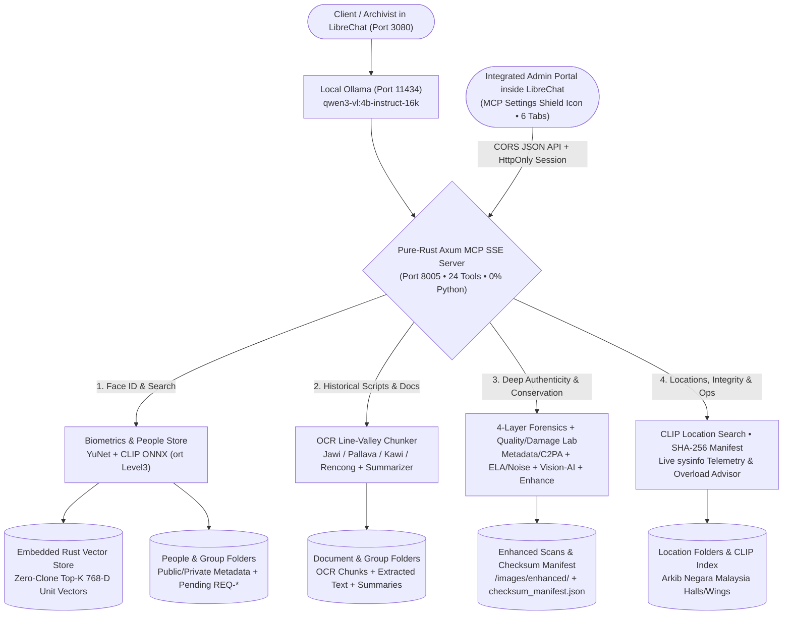

# RojakFace Enterprise Vision, Biometric Identity & Archival Forensics Platform (Pure Rust)

An **air-gapped, 100% on-premise multimodal AI & archival governance platform** written in **100% safe Rust (`#![forbid(unsafe_code)]`, 0% Python)** that integrates **Biometric Face Recognition**, **Privacy-Aware Identity & Visual Photo Retrieval**, **Historical Script OCR (Jawi, Pallava, Kawi, Rencong)**, **4-Layer Deep Authenticity & AI Watermark Forensics**, **Archival Conservation / Damage Healing & Digital Enhancement**, **Managed Location & Document Folders**, and **Live System Performance Monitoring** natively inside **LibreChat** (`http://localhost:3080`) — including the integrated **Admin Portal** right under the **MCP Settings** icon — powered by a single compiled **Rust Axum + Tokio MCP SSE & Headless JSON API Server** (`http://0.0.0.0:8005/sse`).


---

## Table of Contents
1. [Key Features](#1-key-features)
2. [Pure-Rust Architecture & Performance Optimizations](#2-pure-rust-architecture--performance-optimizations)
3. [4-Layer Deep Authenticity & AI Watermark Engine](#3-4-layer-deep-authenticity--ai-watermark-engine)
4. [System Requirements & Prerequisites](#4-system-requirements--prerequisites)
5. [Build & Setup Guide](#5-build--setup-guide)
6. [Running, Stopping & CLI Tools](#6-running-stopping--cli-tools)
7. [Core Processing Pipelines & 24 MCP Tools](#7-core-processing-pipelines--24-mcp-tools)
8. [Integrated Admin Portal & Safe UX Governance](#8-integrated-admin-portal--safe-ux-governance)
9. [Client-Friendly Chatbox Prompts (English & Bahasa Melayu)](#9-client-friendly-chatbox-prompts-english--bahasa-melayu)
10. [Project Structure](#10-project-structure)
11. [Configuration & Environment Variables](#11-configuration--environment-variables)
12. [Testing & Verification](#12-testing--verification)

---

## 1. Key Features

- **100% Pure Safe Rust Backend (`#![forbid(unsafe_code)]`, Zero Python Runtime)**: Compiles to a single ~9 MB native release binary (`rojakface-server.exe`) with `opt-level = 3`, `lto = "thin"`, `codegen-units = 1`, `strip = true`, targeted `tokio` features, sub-second startup, graceful `Ctrl+C` shutdown, and a `GET /health` endpoint.
- **100% Air-Gapped Local AI (Zero Cloud Dependencies)**: Runs entirely on local hardware using **Ollama (`qwen3-vl:4b-instruct-16k`)**, native **ONNX Runtime (`ort`, `GraphOptimizationLevel::Level3`)** for **YuNet** face detection and **CLIP ViT-B/32 (768-D)** embeddings, and an embedded **Pre-Normalized Zero-Clone Top-K SIMD Cosine Vector Store**.
- **Biometric Face Recognition & Auto-Gallery Capture**: Identifies enrolled individuals with an anti-false-positive cosine threshold (`>= 0.88`) and automatically captures new high-confidence (`>= 0.90`), non-duplicate face angles using unified 16×16 perceptual average hashing (`aHash`).
- **Direct Database & Bilingual Visual Attribute Search**: Case- and spacing-insensitive identity lookup supporting photo count limits (*"2 photos only"*), photos-only rendering, and bilingual English/Malay visual attribute queries (*"photo that wear songkok"*, *"pakai cermin mata"*) via per-profile `visual_index.json` + async Ollama vision fallback.
- **Public vs. Private Data Boundary**: Profile attributes are divided into **Public Data** (rendered in centered Markdown tables in chat) and **Private Data** (`license_no`, `dob`, `date_of_birth`, `ic`, `nric`, `passport`, `ssn`, `phone`, `email`, `exp`, `no_kp`, `tarikh_lahir`, strictly hidden from chat and editable only inside the Admin Portal).
- **Historical Malay & Ancient Script OCR & Transliteration**:
  - **Adaptive Line-Valley Chunker** (`rojakface_ocr_document`): Projects horizontal edge energy in microseconds and slices tall/dense manuscripts along natural whitespace valleys (`Top`, `Middle`, `Bottom`) with auto-contrast and `1.4×` sharpening.
  - **Jawi, Pallava, Kawi & Rencong Script Decoder** (`rojakface_decode_jawi`, `rojakface_decode_ancient_script`): Restores 3-dot Jawi (`ڤ ڠ ݢ چ ڽ`), transliterates Unicode **Kawi** (`U+11F00–U+11F5F`) and **Rencong / Surat Ulu** (`U+A930–U+A95F`), normalizes **Pallava** Old Malay / Srivijaya inscriptions with archival glossary notes, and produces searchable digital text.
- **Computer Vision, Archival Location Recognition & Managed Folders (`rojakface_analyze_image`, `rojakface_search_locations`)**:
  - Recognizes buildings, landmarks, and specific halls/wings/galleries (e.g. **Arkib Negara Malaysia / National Archives of Malaysia**) using CLIP ViT-B/32 768-D embeddings against managed **Location Folders**.
  - Extracts full technical & EXIF metadata (file name, size, MIME, dimensions, Date/Time, Camera Make/Model, GPS coordinates, Software, PNG `tEXt`/`iTXt`/`zTXt` chunks, SHA-256, perceptual `aHash`).
- **4-Layer Deep Authenticity, AI Watermark & Copy/Fraud Detection (`rojakface_detect_authenticity`)**:
  - Combines archive duplicate matching (SHA-256 + 16×16 `aHash`), deep C2PA/JUMBF/IPTC/XMP/PNG/JPEG container structure inspection, pixel-level forensics (8×8 ELA, local noise CV, 8×8 JPEG blockiness, lossless LSB probe), and a dedicated zero-temperature observation-first Vision-AI audit to detect **AI-generated**, **digitally manipulated/composite**, **copied/re-encoded external-source**, and **original camera** images.
- **Automatic Description, Archival Summarization & Managed Document Folders (`rojakface_summarize_document`, `rojakface_search_documents`)**:
  - Parses **TXT, MD, CSV, JSON, HTML, XML, DOCX, PDF, and image scans** in pure Rust, generating structured archival summaries, key topics, names, dates, events, script type, and deep authenticity status.
- **Duplicate Prevention & SHA-256 Checksum Integrity (`rojakface_verify_integrity`)**:
  - Guards location photo and document uploads against both exact SHA-256 and perceptual 16×16 `aHash` duplicates across all archive roots (`409 Conflict` with override confirmation in Admin Portal) and audits `data/processed/checksum_manifest.json` for corruption, tampering, missing files, and archive duplicates.
- **Image Quality, Archival Damage Detection, Healing Advice & Digital Enhancement (`rojakface_assess_conservation`, `rojakface_enhance_image`)**:
  - Scores **resolution**, **lighting/exposure**, and **readability/sharpness** (`0–100`).
  - Detects **tear**, **faded**, **mold**, and **aging** classified as **`none` / `light` / `medium` / `heavy`**.
  - Recommends physical conservation treatments (**fungal removal**, **controlled drying**, **Japanese Kozo tissue mending**, **deacidification**, **protective coating/sizing**, **UV-filtered storage**) and enhances scans digitally with Before vs. After metrics.
- **Administration System Performance & Overload Monitoring (`rojakface_system_health`)**:
  - Live telemetry (`sysinfo`) of CPU %, RAM GB/%, Disk GB/%, Server Process RSS MB, Ollama ping latency, request throughput, error rates, and RAII-guarded in-flight concurrency — detects abnormalities and overload (`HEALTHY` / `WARNING` / `CRITICAL_OVERLOAD`) with concrete recommended actions plus one-click integrity check and temp cache cleanup.
- **Native LibreChat-Embedded Admin Portal with Maintainable Group Folders**:
  - Embedded natively inside LibreChat (`http://localhost:3080`) via the Shield-Check icon directly under **MCP Settings** (same Light/Dark theme and layout; standalone `http://127.0.0.1:8005/admin` redirects straight into `http://localhost:3080/#rojakface-admin`).
  - Organizes **Enrolled People** (`Staff`, `External Entity`, plus custom folders) and **Archival Documents** (`Historical Manuscripts`, `Official Records`, plus custom folders) with safe **⋮ Three-Dot Menus**, **Trash Can icons**, **Custom Confirmation Modals**, and **Ghost Red Delete buttons**.

---

## 2. Pure-Rust Architecture & Performance Optimizations



| Rust Module | Key Optimizations & Safety Properties |
| :--- | :--- |
| [src/main.rs](src/main.rs) | Tokio + Axum headless server, `GET /health`, graceful `Ctrl+C` shutdown, CLI tools (`--verify-face`, `--enroll-dir`), and RAII `InFlightGuard` middleware so dropped/cancelled requests never leak concurrency counters. |
| [src/config.rs](src/config.rs) | Environment config, archive directory bootstrapping (`profiles/`, `locations/`, `documents/`, `pending_requests/`), persistent admin key, and ONNX Runtime / model auto-discovery. |
| [src/biometrics.rs](src/biometrics.rs) | Dynamic ONNX Runtime (`ort`) with `GraphOptimizationLevel::Level3`, balanced `intra_threads` (`2..=4`), YuNet 640×640 + NMS (`IoU 0.30`), and CLIP ViT-B/32 `square_pad` + bicubic 224×224 normalization. |
| [src/vector_store.rs](src/vector_store.rs) | Pre-computes L2-normalized 768-D `unit_vector` on load/upsert; `search()` uses **zero-clone index scoring + `select_nth_unstable_by`** (cloning only the top-K winners) with atomic temp-file rename persistence. |
| [src/vision_ops.rs](src/vision_ops.rs) | Pure-Rust EXIF orientation decoding (`kamadak-exif`), unified 16×16 perceptual `aHash` (`perceptual_hash_from_image` / `from_bytes`), O(N) prefix-sum moving-average OCR line-valley chunker, autocontrast, and sharpening. |
| [src/forensics.rs](src/forensics.rs) | **Single-read / single-decode** pipeline for file metadata, C2PA/JUMBF, IPTC `DigitalSourceType`, XMP, PNG chunks, deep JPEG segment/DQT parser, 8×8 ELA/noise/blockiness/lossless-LSB pixel forensics, deterministic visual fusion, upload duplicate guard, and SHA-256 manifest audit. |
| [src/conservation.rs](src/conservation.rs) | Pure-Rust image quality analyzer (resolution, lighting, readability), 4-class damage detector (`tear`, `faded`, `mold`, `aging` as `none`/`light`/`medium`/`heavy`), physical conservation advisor, and 5-mode digital enhancer. |
| [src/jawi.rs](src/jawi.rs) | Zero-`unsafe`, zero-`.unwrap()` Jawi-to-Rumi orthographic and phonetic skeleton decoder with 3-dot Jawi restoration, classical Malay lexicon, and reduplication (`٢`) support. |
| [src/ancient_scripts.rs](src/ancient_scripts.rs) | Auto-detects and transliterates **Jawi**, **Pallava**, **Kawi** (`U+11F00–U+11F5F`), and **Rencong / Surat Ulu** (`U+A930–U+A95F`) with Old Malay / Srivijaya archival glossary notes. |
| [src/archives.rs](src/archives.rs) | Manages **Archival Locations**, **Archival Documents**, **People Group Folders**, and **Document Group Folders**, plus pure-Rust DOCX/PDF/HTML/XML/TXT text extraction and Ollama archival summarization. |
| [src/monitor.rs](src/monitor.rs) | Lightweight targeted `sysinfo` startup (`CpuRefreshKind` + `MemoryRefreshKind` only, no full OS process scan), live CPU/RAM/Disk/RSS/Ollama telemetry, and `HEALTHY`/`WARNING`/`CRITICAL_OVERLOAD` advisor. |
| [src/metadata.rs](src/metadata.rs) | ASCII/Unicode slugging, identity normalization, 12-hour AM/PM time formatting, bilingual English/Malay sensitive-field privacy classification, and truncated JSON recovery. |
| [src/service.rs](src/service.rs) | Orchestrates all **24 MCP tools**, concurrent `tokio::join!` overlap of CPU/ONNX work with Ollama vision inference (`analyze_authenticity_deep`, `tool_analyze_image`, `tool_assess_conservation`), LibreChat attachment resolution, perceptual ID cache, and staging queue. |
| [src/mcp_sse.rs](src/mcp_sse.rs) | Standard MCP 2024-11-05 SSE transport (`GET /sse`, `POST /messages/`) with `Drop`-guarded session cleanup, DNS-rebinding `Host` guard, async dispatch for I/O/AI tools, and `spawn_blocking` workers for heavy CPU tasks. |
| [src/admin.rs](src/admin.rs) | Headless CORS-enabled JSON Admin API consumed natively inside LibreChat, constant-time login, `HttpOnly; SameSite=Lax` 8-hour session cookies, safe filename path-traversal guards, and 32 MB multipart limit. |

---

## 3. 4-Layer Deep Authenticity & AI Watermark Engine

Every authenticity check (`rojakface_detect_authenticity`, `rojakface_analyze_image`, `rojakface_assess_conservation`, `rojakface_summarize_document`, and the Admin Portal **System & Lab** tab) runs four complementary local forensic layers and fuses them deterministically in Rust:

1. **Layer 1 — Archive Duplicate & Integrity Matching**:
   - Exact **SHA-256** match and unified **16×16 perceptual `aHash`** near-duplicate detection across `profiles/`, `locations/`, and `documents/`.
2. **Layer 2 — Deep Metadata, Watermark & Container Structure**:
   - Inspects **C2PA / Content Credentials** (`APP11 JUMBF` boxes & raw `c2pa`/`contentcredentials` headers), **IPTC/XMP `DigitalSourceType`** (`trainedAlgorithmicMedia`, `compositeSynthetic`), XMP `CreatorTool`, PNG prompt/workflow chunks (`parameters`, `prompt`, `workflow`, `sd-metadata`), **47+ AI generator markers**, and **external platform/stock markers** (`FBMD`/`FBMN`, WhatsApp, Telegram, TikTok, Getty, Shutterstock, Alamy, Screenshot).
   - Parses raw JPEG segment headers (`APP0`–`APP14`, `COM`, `SOF2`, `DQT` quantization quality) to flag **bare stripped JPEG containers** (`0` APP/EXIF/JFIF/ICC/XMP headers — strong fingerprint of web/social re-encoded copies or stripped AI downloads).
3. **Layer 3 — Pixel-Level Forensics**:
   - **8×8 Error Level Analysis (ELA)** spatial splice disparity (`p95/median` ratio), **local high-pass sensor noise CV**, **8×8 JPEG block-grid boundary ratio**, and a **lossless-only LSB bit-plane statistical probe** (scoped to `.png`/`.bmp` so normal JPEG DCT quantization never triggers false LSB signals).
4. **Layer 4 — Zero-Temperature Observation-First Vision-AI Forensic Audit**:
   - Queries local Ollama (`qwen3-vl:4b-instruct-16k`, `temperature: 0`, `384px` input) for concrete factual observations (`scene_description`, `physically_possible_in_real_life`, `has_garbled_ai_text`, `visible_watermark`, `is_screenshot_or_repost`) — checking visible AI/stock corner watermarks (Gemini sparkle, Veo, Sora, Kling, Meta AI, TikTok, Getty, Shutterstock), physically impossible composites (e.g. human head grafted onto a robot body), and garbled AI text — and deterministically fuses the result in Rust (`fuse_visual_audit`) without false positives on normal portraits.
- **Note on Proprietary Invisible Watermarks**: Open provenance standards (C2PA/JUMBF, IPTC `DigitalSourceType`, PNG/XMP AI chunks, visible watermarks, and lossless LSB anomalies) are verified offline. Proprietary cryptographic pixel watermarks such as **Google SynthID** cannot be decoded locally without Google's private verification API — this caveat is transparently reported in every output.

---

## 4. System Requirements & Prerequisites

| Requirement | Minimum / Recommended Specification |
| :--- | :--- |
| **Operating System** | Windows 10/11 (64-bit), Linux, or macOS |
| **Rust Toolchain** | Rust **1.97+** (`cargo`, `rustc`, edition 2024) — *no Python required at runtime* |
| **ONNX Runtime & Models** | `onnxruntime.dll` (or `.so`/`.dylib`) in `models/runtime/`, plus `yunet_face_detector.onnx` and `patch32_v1.onnx` in `models/` (or `~/.cache/`) |
| **Docker** | **Docker Desktop** (Compose v2) for LibreChat (`http://localhost:3080`) |
| **Ollama** | **Ollama** (`http://127.0.0.1:11434`) running `qwen3-vl:4b-instruct-16k` |

---

## 5. Build & Setup Guide

### Step 1 — Clone & Compile the Pure-Rust Binary
```powershell
git clone https://github.com/Hamzahxvi/rojakface-enterprise-vision.git
cd rojakface-enterprise-vision

cargo build --release
```

### Step 2 — Pull & Build the Local Ollama Model
```powershell
ollama pull qwen3-vl:4b-instruct
ollama create qwen3-vl:4b-instruct-16k -f models/Modelfile
```

### Step 3 — Configure Sibling LibreChat (`../LibreChat`)
```powershell
if (-not (Test-Path ..\LibreChat)) {
    git clone https://github.com/danny-avila/LibreChat.git ..\LibreChat
    Copy-Item ..\LibreChat\.env.example ..\LibreChat\.env
}
New-Item -ItemType Directory -Force -Path ..\LibreChat\images | Out-Null

Copy-Item config\librechat\librechat.yaml ..\LibreChat\librechat.yaml -Force
Copy-Item config\librechat\docker-compose.override.yml ..\LibreChat\docker-compose.override.yml -Force
Copy-Item config\librechat\custom-index.html ..\LibreChat\custom-index.html -Force
Copy-Item config\librechat\royal-theme.css ..\LibreChat\images\royal-theme.css -Force
Copy-Item config\librechat\admin-embed.js ..\LibreChat\images\admin-embed.js -Force
```

### Step 4 — Optional First-Time Batch Face Enrollment (Pure Rust)
Seed the embedded vector store (`data/processed/rojakface_vectors.json`) and profile galleries from `data/raw/staff_enroll/`:
```powershell
.\target\release\rojakface-server.exe --enroll-dir data\raw\staff_enroll
```

---

## 6. Running, Stopping & CLI Tools

### One-Click Launch & Shutdown (Windows)
```powershell
# Start Ollama + rojakface-server.exe (8005) + LibreChat (3080)
cmd /c start.bat

# Stop rojakface-server.exe cleanly
cmd /c stop.bat
```

### Manual CLI Commands & Health Check
```powershell
# Run the MCP SSE + Headless Admin JSON API server
.\target\release\rojakface-server.exe

# Health check endpoint
curl http://127.0.0.1:8005/health

# Offline biometric face identification check on any image
.\target\release\rojakface-server.exe --verify-face path\to\portrait.jpg

# Batch enroll all subdirectories under a folder (<dir>/<Person Name>/*.jpg)
.\target\release\rojakface-server.exe --enroll-dir data\raw\staff_enroll
```

---

## 7. Core Processing Pipelines & 24 MCP Tools

Exposed over standard MCP SSE (`http://host.docker.internal:8005/sse` and `/messages/`):

| Pipeline | MCP Tool | Description |
| :--- | :--- | :--- |
| **Pipeline A: Biometric Face ID** | `rojakface_identify_faces` | YuNet face detection + 768-D CLIP embeddings + zero-clone SIMD cosine match (`>= 0.88`), auto-gallery capture (`>= 0.90`), returns `MATCHED`, `NOT_IN_DATABASE`, or `NO_FACE_DETECTED` (with `ocr_document_chunks`). |
| | `rojakface_detect_faces` | Low-level YuNet bounding box `[x, y, w, h]` and confidence inspection. |
| **Pipeline B: People, Locations & Documents Search** | `rojakface_search_identity` | Case/spacing-insensitive profile lookup supporting `limit`, `photos_only`, and bilingual English/Malay visual `query`. |
| | `rojakface_list_identities` | Lists all enrolled identities grouped by People Group Folder (`Staff`, `External Entity`, custom) and reference vector counts. |
| | `rojakface_search_locations` | Searches/lists managed archival **Location** folders (e.g. Arkib Negara Malaysia halls/wings/rooms) with coordinates, history, and gallery photos. |
| | `rojakface_search_documents` | Searches/lists managed archival **Document** folders (with group folder metadata) by title, reference code, script, topic, or extracted digital text. |
| **Pipeline C: Historical Script OCR, Vision & Deep Authenticity** | `rojakface_ocr_document` | Adaptive horizontal edge-energy line-valley chunking with autocontrast & `1.4×` sharpening (`/images/ocr-chunks/`). |
| | `rojakface_decode_jawi` | Decodes Jawi script or rough transliterations into corrected 3-dot Jawi (`ڤ ڠ ݢ چ ڽ`) and Standard Bahasa Melayu (Rumi). |
| | `rojakface_decode_ancient_script` | Auto-detects & transliterates **Jawi**, **Pallava**, **Kawi** (`U+11F00–U+11F5F`), and **Rencong / Surat Ulu** (`U+A930–U+A95F`) with archival Old Malay glossary notes. |
| | `rojakface_analyze_image` | All-in-one concurrent check: extracts full file/EXIF/GPS/PNG metadata, runs the **4-layer deep authenticity check**, assesses archival quality & damage, counts faces, and matches buildings/landmarks via CLIP 768-D against managed Locations. |
| | `rojakface_detect_authenticity` | **4-layer forensic authenticity & AI watermark detector**: archive duplicates (SHA-256 + `aHash`), C2PA/IPTC/XMP/PNG/bare-JPEG header inspection, ELA/noise/blockiness/LSB pixel forensics, and zero-temp Vision-AI forensic audit. |
| | `rojakface_summarize_document` | Multi-format (TXT/MD/CSV/JSON/HTML/DOCX/PDF/Image) automatic archival description & structured summary (topics, names, dates, events, and deep authenticity). |
| **Pipeline D: Archival Conservation, Integrity & Ops** | `rojakface_assess_conservation` | Concurrently evaluates resolution, lighting, readability, detects tear/faded/mold/aging (`none`/`light`/`medium`/`heavy`), runs the **4-layer deep authenticity check**, and suggests physical healing treatments. |
| | `rojakface_enhance_image` | Digitally enhances dark, yellowed, or faded archival images (gray-world de-yellowing, gamma lighting, autocontrast, unsharp mask) with Before vs. After quality scores. |
| | `rojakface_verify_integrity` | Audits SHA-256 file integrity across `profiles/`, `locations/`, and `documents/` against `checksum_manifest.json` to flag corruption, tampering, missing files, and exact duplicates. |
| | `rojakface_system_health` | Live administration telemetry (CPU, RAM, Disk, RSS, Ollama latency, workload/errors) with abnormality/overload detection (`HEALTHY`/`WARNING`/`CRITICAL_OVERLOAD`) and recommended actions. |
| **Pipeline E: Role-Based Governance** | `rojakface_request_enrollment` | Stages a Guest enrollment request (`REQ-*`) for Admin review. |
| | `rojakface_request_update_metadata` | Stages a Guest metadata/MyKad/ID-card update request (`REQ-*`), auto-classifying English & Malay sensitive keys as `private`. |
| | `rojakface_list_pending_requests` | Lists pending, approved, or rejected staging requests. |
| | `rojakface_review_pending_request` | Admin-key guarded approval/rejection tool. |
| | `rojakface_enroll_named_identity` | Admin direct enrollment tool (auto-stages for Guests). |
| | `rojakface_enroll_or_learn` | Admin batch learning tool. |
| | `rojakface_rename_identity` | Admin rename across vector store, profiles, and gallery. |
| | `rojakface_delete_identity` | Admin delete across vector store and stored files. |

---

## 8. Integrated Admin Portal & Safe UX Governance

Open **LibreChat (`http://localhost:3080`)** and click the **Admin Portal** shield-check icon directly underneath **MCP Settings** in the left navigation rail:

- **Native LibreChat Theme & Layout**: Rendered directly inside LibreChat using LibreChat's exact Light/Dark CSS variables (no separate standalone `:8005/admin` page or iframe; visiting `http://127.0.0.1:8005/admin` automatically redirects `307` to `http://localhost:3080/#rojakface-admin`).
- **Session Auth**: Constant-time credential verification (`POST /admin/api/login`) with 8-hour `HttpOnly; SameSite=Lax` session cookies (`ROJAKFACE_ADMIN_USER` / `ROJAKFACE_ADMIN_PASS`).
- **Maintainable Group Folders**:
  - **Enrolled People Group Folders** (`Staff`, `External Entity`, plus custom folders): create, rename, assign via dropdown-chevron selector on each card, or delete safely (deleting a group moves members to `Unassigned` without deleting their profiles).
  - **Document Group Folders** (`Historical Manuscripts`, `Official Records`, plus custom folders): create, rename, assign per document, or delete safely.
- **Misclick-Safe Destructive UX**:
  - Group folder actions use a **⋮ Three-Dot Menu** (`Rename Group` / `Delete Group`) instead of exposed inline `×` buttons.
  - All destructive actions use **Trash Can SVG icons**, **ghost/outline red Delete buttons** (`border: 1px solid #ef4444; color: #ef4444`, filling solid red only on hover), and **Custom Confirmation Modals** specifying exact impact before deletion (e.g., *"Delete Ahmad Zahid Hamidi and their 2 vector(s) / photo(s)?"*).
- **6 Integrated Tabs**:
  1. **📋 Approvals**: Review, approve, or reject Guest enrollment and metadata update requests.
  2. **👥 People**: Manage group folders, Public vs. Private custom fields, and per-photo metadata/galleries.
  3. **📍 Locations**: Manage CLIP-indexed halls/wings/landmarks with duplicate upload guard.
  4. **📁 Documents**: Manage document group folders, multi-format uploads with duplicate guard, and one-click Auto-Summarize.
  5. **📊 System & Lab**: Live CPU/RAM/Disk/Ollama telemetry, SHA-256 archive integrity audit, temp cache cleanup, and the **Archival Quality, Damage, Deep Authenticity & Enhancement Lab**.
  6. **🔍 Test Face**: Dry-run face recognition with custom confidence threshold without altering records.

---

## 9. Client-Friendly Chatbox Prompts (English & Bahasa Melayu)

Clients do not need IT jargon — everyday wording is automatically mapped to the right MCP tool:

### English Prompts
- **General Photo Check** *(attach photo)*: `check this` / `what is this?` / `what building or place is this?`
- **Deep Authenticity & AI Watermark Check** *(attach photo)*: `is this real or fake?` / `is this AI-generated or copied from another source?` / `check watermark and metadata`
- **Quality, Damage & Healing** *(attach scan)*: `is this damaged, torn, mouldy, or faded? how do we heal or preserve it?`
- **Digital Enhancement** *(attach dark/old scan)*: `make this clearer` / `brighten and restore this old photo`
- **Face Identification & Lookup**: `who is this? show all details and photos` / `show lando zawawi photos, 2 photos only` / `show lando zawawi photo wearing songkok`
- **Historical Scripts & Summaries**: `read this jawi manuscript, convert to rumi, and explain the meaning` / `transcribe this kawi/pallava/rencong inscription` / `summarize this document`
- **Archive Integrity & System Health**: `are our archive files safe or duplicated?` / `how is the system doing? is anything slow or overloaded?`

### Bahasa Melayu (Malaysia) Prompts
- **Semakan Umum & Ketulenan** *(lampirkan gambar)*: `tengok gambar ini` / `gambar ini tulen, palsu, gambar AI, atau salinan?` / `sudah ada dalam sistem ke?`
- **Kualiti, Kerosakan & Pemuliharaan** *(lampirkan imbasan)*: `gambar ini rosak, koyak, pudar, atau berkulat tak? macam mana nak baiki dan jaga?` / `jelaskan dan baiki gambar lama ini`
- **Pengecaman Wajah & Carian Profil**: `siapa ini? tunjuk maklumat penuh dan semua gambar beliau` / `tunjuk 2 gambar lando zawawi sahaja` / `tunjuk gambar lando zawawi yang pakai songkok`
- **OCR Tulisan Lama & Ringkasan**: `baca tulisan jawi ini, tukar ke rumi, dan jelaskan maksudnya` / `ringkaskan dokumen ini`
- **Integriti Fail & Kesihatan Sistem**: `semak fail arkib ada rosak atau pendua tak?` / `sistem ok ke? kenapa lambat?`

---

## 10. Project Structure

```text
├── Cargo.toml                      # Pure-Rust package manifest (rojakface-server v2.0.0)
├── Cargo.lock                      # Reproducible Rust dependency lockfile
├── src/                            # 100% safe Rust (#![forbid(unsafe_code)])
│   ├── main.rs                     # Tokio + Axum server, /health, RAII monitor guard, graceful shutdown & CLI
│   ├── config.rs                   # Environment config, paths & ONNX/DLL auto-discovery
│   ├── biometrics.rs               # Native YuNet ONNX face detector + CLIP ViT-B/32 embedder
│   ├── vector_store.rs             # Embedded zero-clone top-K 768-D SIMD cosine vector store
│   ├── vision_ops.rs               # EXIF orientation, unified 16x16 perceptual aHash, OCR line-valley chunker
│   ├── jawi.rs                     # Jawi-to-Rumi orthographic & phonetic skeleton decoder
│   ├── ancient_scripts.rs          # Jawi, Pallava, Kawi & Rencong script decoder & archival glossary
│   ├── forensics.rs                # 4-layer authenticity, C2PA/IPTC/JPEG/ELA/LSB forensics, duplicate guard & SHA-256 manifest
│   ├── conservation.rs             # Image quality, tear/faded/mold/aging classifier, healing advisor & digital enhancer
│   ├── monitor.rs                  # Live CPU/RAM/Disk/Ollama telemetry, abnormality & burden overload advisor
│   ├── archives.rs                 # Managed Locations, Documents, People/Document Group Folders & summarizer
│   ├── metadata.rs                 # Slugs, identity normalization, 12h time, bilingual privacy classification
│   ├── service.rs                  # Core business logic & concurrent tokio::join! pipelines for all 24 MCP tools
│   ├── mcp_sse.rs                  # MCP-over-SSE server (/sse & /messages/) + DNS-rebinding Host guard
│   └── admin.rs                    # Headless CORS-enabled JSON Admin API consumed natively inside LibreChat
├── config/
│   ├── librechat/                  # librechat.yaml, docker-compose.override.yml, custom-index.html, royal-theme.css, admin-embed.js
│   └── settings.json               # Thresholds, ports & vector store settings
├── data/
│   └── raw/staff_enroll/           # Sample enrollment source portraits
├── models/
│   └── Modelfile                   # Ollama Modelfile for qwen3-vl:4b-instruct-16k
├── reports/
│   └── pipeline_diagram.svg        # Pure-Rust architecture diagram
├── Dockerfile                      # Multi-stage Pure-Rust Docker image with HEALTHCHECK
├── start.bat                       # One-click launch (Ollama + rojakface-server.exe + LibreChat)
├── stop.bat                        # One-click shutdown for rojakface-server.exe
└── README.md
```

---

## 11. Configuration & Environment Variables

| Variable | Default | Purpose |
| :--- | :--- | :--- |
| `ROJAKFACE_HOST` | `0.0.0.0` | Bind host for MCP SSE, `/health`, & Admin JSON API |
| `ROJAKFACE_PORT` | `8005` | Port for `/sse`, `/health`, and `/admin/api/*` |
| `ROJAKFACE_ADMIN_USER` | `admin` | Admin Portal login username |
| `ROJAKFACE_ADMIN_PASS` | `admin123` | Admin Portal login password (override in production) |
| `ROJAKFACE_ADMIN_KEY` | *(persisted in `.rojakface_admin_key`)* | Internal secret key for Admin-only MCP operations |
| `ROJAKFACE_OLLAMA_URL` | `http://127.0.0.1:11434/api/chat` | Local Ollama endpoint for visual search, summarization & visual forensic audit |
| `ROJAKFACE_VISION_MODEL` | `qwen3-vl:4b-instruct-16k` | Local Ollama multimodal model |
| `ORT_DYLIB_PATH` | *(auto-discovered in `models/runtime/`)* | Path to `onnxruntime.dll` / `libonnxruntime.so` |
| `ROJAKFACE_YUNET_MODEL` | *(auto-discovered in `models/` or `~/.cache/`)* | Path to `yunet_face_detector.onnx` |
| `ROJAKFACE_CLIP_MODEL` | *(auto-discovered in `models/` or `~/.cache/`)* | Path to `patch32_v1.onnx` |
| `LIBRECHAT_DIR` | `../LibreChat` | Path to sibling LibreChat directory |
| `LIBRECHAT_URL` | `http://localhost:3080` | Base URL for profile gallery, OCR chunks, enhanced images & Admin Portal redirect |

---

## 12. Testing & Verification

```powershell
# Format check + strict zero-warning lint
cargo fmt --check
cargo clippy --all-targets -- -D warnings

# Run all 17 unit tests (biometrics, vector store, vision ops, Jawi, ancient scripts,
# forensics/duplicate guard/visual fusion, conservation, archives/groups, monitor, MCP catalog)
cargo test

# Build optimized release binary
cargo build --release
```
