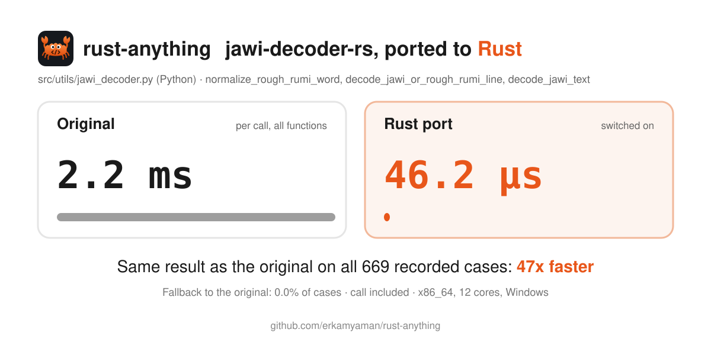

## `jawi-decoder-rs` in Rust

| | |
| --- | --- |
| Unit | `src/utils/jawi_decoder.py` (Python) |
| Recorded cases matched | 669 / 669 |
| Speedup, call included | 47x (geometric mean) |
| Fallback to the original | 0.0% (0 of 669 cases) |
| Switched on | on |

| Function | Cases | Original per call | Rust per call | Speedup |
| --- | ---: | ---: | ---: | ---: |
| `normalize_rough_rumi_word` | 223 | 178.1 µs | 3.9 µs | 46x |
| `decode_jawi_or_rough_rumi_line` | 223 | 960.4 µs | 22.4 µs | 43x |
| `decode_jawi_text` | 223 | 1.0 ms | 19.9 µs | 51x |

Measured with `rust-anything report` on x86_64, 12 cores, Windows: `diff` replays every recorded case, `bench` times them on both sides as callers call them. Reproduce: `rust-anything diff` and `rust-anything bench` in the crate folder.
