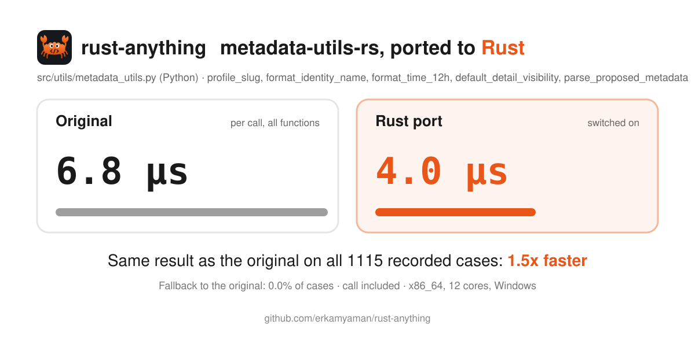

## `metadata-utils-rs` in Rust

| | |
| --- | --- |
| Unit | `src/utils/metadata_utils.py` (Python) |
| Recorded cases matched | 1115 / 1115 |
| Speedup, call included | 1.5x (geometric mean) |
| Fallback to the original | 0.0% (0 of 1115 cases) |
| Switched on | on |

| Function | Cases | Original per call | Rust per call | Speedup |
| --- | ---: | ---: | ---: | ---: |
| `profile_slug` | 223 | 1.4 µs | 520 ns | 2.7x |
| `format_identity_name` | 223 | 1.0 µs | 875 ns | 1.2x |
| `format_time_12h` | 223 | 1.9 µs | 847 ns | 2.3x |
| `default_detail_visibility` | 223 | 1.9 µs | 828 ns | 2.3x |
| `parse_proposed_metadata` | 223 | 479 ns | 909 ns | 0.5x |

Measured with `rust-anything report` on x86_64, 12 cores, Windows: `diff` replays every recorded case, `bench` times them on both sides as callers call them. Reproduce: `rust-anything diff` and `rust-anything bench` in the crate folder.
