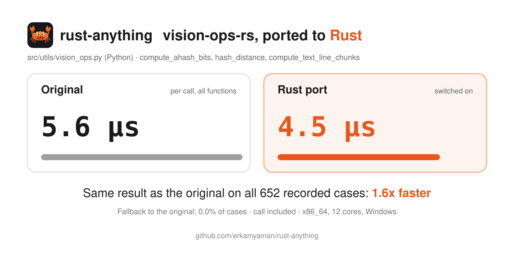

## `vision-ops-rs` in Rust

| | |
| --- | --- |
| Unit | `src/utils/vision_ops.py` (Python) |
| Recorded cases matched | 652 / 652 |
| Speedup, call included | 1.6x (geometric mean) |
| Fallback to the original | 0.0% (0 of 652 cases) |
| Switched on | on |

| Function | Cases | Original per call | Rust per call | Speedup |
| --- | ---: | ---: | ---: | ---: |
| `compute_ahash_bits` | 201 | 995 ns | 515 ns | 1.9x |
| `hash_distance` | 233 | 969 ns | 479 ns | 2.0x |
| `compute_text_line_chunks` | 218 | 3.6 µs | 3.5 µs | 1.0x |

Measured with `rust-anything report` on x86_64, 12 cores, Windows: `diff` replays every recorded case, `bench` times them on both sides as callers call them. Reproduce: `rust-anything diff` and `rust-anything bench` in the crate folder.
